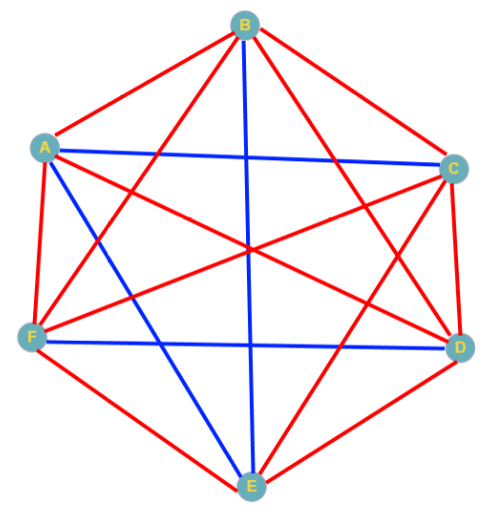

# יחידת העשרה: אלגוריתמים בסיסיים, הצפנה וגבולות החישוב



> *"מדעי המחשב אינם עוסקים במחשבים יותר משאסטרונומיה עוסקת בטלסקופים."*  
> — **אדסחר דייקסטרה (Edsger W. Dijkstra)**

ברוכים הבאים ליחידת ההעשרה של הקורס! עד כה רכשתם מיומנות מעשית בכתיבת קוד פייתון: משתנים, תנאים, לולאות, פונקציות, מילונים, עיבוד קבצי טבלה, ויזואליזציה של נתונים ועיבוד תמונות דיגיטליות.

ביחידה זו נצלול אל השאלות המדעיות והתיאורטיות העמוקות ביותר שעומדות בבסיס מדעי המחשב:
1. **בעיית החיפוש (Search):** כיצד מוצאים פריט בתוך מיליארד נתונים בשבריר שנייה?
2. **בעיית המיון (Sort):** כיצד מארגנים מידע ביעילות ומדוע מיון הוא המפתח לאלגוריתמיקה מתקדמת?
3. **קריפטוגרפיה ואבטחת מידע:** כיצד מעבירים מסרים סודיים בערוץ פתוח (צופן קיסר, צופן הצבה וניתוח תדירויות)?
4. **תורת הקודים ותיקון שגיאות:** כיצד שולחים מידע בסביבה רועשת ומגלים/מתקנים שגיאות בלתי נמנעות (ביט זוגיות וקסם הקלפים)?
5. **גבולות החישוב:** האם יש בעיות שמחשב לעולם לא יוכל לפתור? (בעיית העצירה של אלן טיורינג).

---

## 🗺️ מפת השיעורים ביחידה

```
[מבוא לחיפוש] ──> [חיפוש סדרתי O(n)] ──> [חיפוש בינארי O(log n)]
      │
      └───> [מיון בחירה Selection Sort] ──> [השוואת מיון בפייתון]
                  │
                  └───> [קריפטוגרפיה: קיסר והצבה] ──> [ביט זוגיות ותיקון שגיאות] ──> [בעיית העצירה]
```

### פירוט פרקי היחידה:
1. **[1. בעיית החיפוש ומבוא](1_search_problems.md)** – הגדרת הקלט, הפלט והמדדים ליעילות.
2. **[2. חיפוש סדרתי (Linear Search)](2_linear_search.md)** – המימוש הישיר וסיבוכיות $O(n)$.
3. **[3. חיפוש בינארי (Binary Search)](3_binary_search.md)** – אסטרטגיית "הפרד ומשול", לוגריתמים וסיבוכיות $O(\log n)$.
4. **[4. מיון בחירה (Selection Sort)](4_selection_sort.md)** – סידור רשימות, אינווריאנטה ומימוש מעשי.
5. **[5. השוואת ביצועים ומיון בפייתון](5_sorting_comparison.md)** – Timsort, פונקציות `sort()` מול `sorted()`.
6. **[6. צופן קיסר (Caesar Cipher)](6_caesar_cipher.md)** – היסט מודולרי, פענוח והתקפת כוח גס (Brute-force).
7. **[7. צופן הצבה וניתוח תדירויות](7_substitution_cipher.md)** – הצפנה מתקדמת ושבירתה באמצעות סטטיסטיקה לשונית.
8. **[8. גילוי שגיאות: ביט זוגיות (Parity Bit)](8_error_detection_parity.md)** – ערוצי תקשורת רועשים, סכום מודולו 2 וגילוי שגיאה בודדת.
9. **[9. תיקון שגיאות: קסם הקלפים (2D Parity)](9_error_correction_cards.md)** – מערך שתי-ממדי, הצלבת שורות ועמודות ואלגוריתמי המינג.
10. **[10. גבולות החישוב: בעיית העצירה](10_halting_problem.md)** – שאלת טיורינג המכרעת והוכחה יפהפייה בדרך השלילה.
11. **[11. בוחן מסכם והערכה עצמית](11_enrichment_summary_quiz.md)** – שאלות הבנה מעמיקות לסיכום פרק ההעשרה.