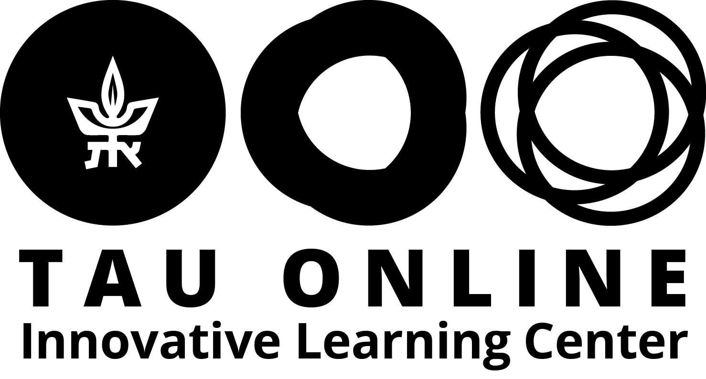
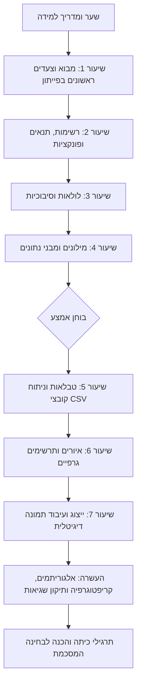

# Python for Life Sciences 101 - TAU
### צעדים ראשונים במדעי המחשב ותכנות בפייתון למדעי החיים

  

    🎬 הרצאת וידאו: פרומו והיכרות עם קורס צעדים ראשונים בפייתון
    מרצה: פרופ' בני שור וד"ר אמיר רובינשטיין | אוניברסיטת תל אביב
  

  

    <iframe 
      src="https://www.youtube-nocookie.com/embed/dQWtmzjHI2A" 
      title="פרומו והיכרות עם קורס צעדים ראשונים בפייתון" 
      style="position: absolute; top: 0; left: 0; width: 100%; height: 100%; border:0;" 
      allow="accelerometer; autoplay; clipboard-write; encrypted-media; gyroscope; picture-in-picture" 
      allowfullscreen>
    </iframe>
  

  

    🔗 <a href="https://www.youtube.com/watch?v=dQWtmzjHI2A" target="_blank" style="color: #2563eb; text-decoration: none;">Watch on YouTube</a> | 
    <a href="https://www.youtube.com/playlist?list=PLZkJ6lmZSF_ylSMai1DAB1T2nRAK8Q_RA" target="_blank" style="color: #2563eb; text-decoration: none;">TAU Full Course Playlist</a>
  

> **קורס מקוון מאת אוניברסיטת תל אביב והמיזם הלאומי ללמידה דיגיטלית קמפוס IL**  
> **מרצים ומפתחים:** פרופ' בני שור ז"ל וד"ר אמיר רובינשטיין, בית הספר למדעי המחשב, אוניברסיטת תל אביב  
> **צוות יישומי מדעי החיים:** ד"ר מארק, ד"ר רותם וד"ר אופיר  
> **קישור לקורס המקורי:** [Campus IL - קורס פייתון TAU](https://app.campus.gov.il/learning/course/course-v1:TAU+ACD_PythonIntro_HE+2026_1/home)

---

## ברוכים הבאים למסע שלכם בעולם מדעי המחשב!

שאלתם את עצמכם פעם איך מחשבים באמת עובדים? ממה הם בנויים ואיך גורמים לחתיכות של מתכת, פלסטיק וסיליקון לבצע חישובים מורכבים, לזהות פנים בתמונות, לתכנן מסלולים ב-Waze או לנהל את כל המידע בעולם?

למרות שהמחשבים חיוניים כמעט בכל היבט בחיינו ועל אף שאנחנו עושים בהם שימוש יומיומי רצוף, רובנו מוצאים את עצמנו נבוכים מול השאלות הללו. היום זה כבר ברור לחלוטין: **כדי להבין טוב יותר את העולם הטכנולוגי שסביבנו, צריך להבין מחשבים.** אנחנו נתקלים במושגים כמו ביטים ובייטים, 0 ו-1, אלגוריתמים ותכנות – אבל מה הם באמת אומרים?

ספר אינטראקטיבי זה (בפורמט Jupyter Book) מביא אליכם את מלוא תכני הקורס האקדמי המוביל של אוניברסיטת תל אביב. הקורס תוכנן בקפידה עבור **לומדים ללא שום רקע מוקדם בתכנות או במדעי המחשב**, ומוביל אתכם צעד אחר צעד – מההבנה התיאורטית של "מהו אלגוריתם" ועד לכתיבת תוכניות פייתון מתקדמות לעיבוד תמונות, ניתוח נתונים והצפנת מידע.

---

## מה נלמד בספר?

הספר משלב בין **רעיונות תיאורטיים עמוקים במדעי המחשב** לבין **מיומנות מעשית בכתיבת קוד בשפת Python**:

1. **מושגי יסוד:** חומרה מול תוכנה, ייצוג מידע בבסיס בינארי, חשיבה חישובית ובעיית השידוך היציב (אלגוריתם Gale-Shapley).
2. **יסודות שפת פייתון:** טיפוסי נתונים (`int`, `float`, `str`, `bool`), משתנים, פעולות חשבוניות, משפטי תנאי (`if-else`), ופונקציות (`def`).
3. **מבני נתונים בסיסיים ומתקדמים:** רשימות (`list`), רשימות מקוננות (מטריצות), ומילונים (`dict`).
4. **בקרת זרימה:** לולאות `for`, טווחים (`range`), לולאות `while`, לולאות מקוננות ומניעת לולאות אינסופיות.
5. **יעילות וסיבוכיות אלגוריתמית:** מושג סיבוכיות זמן ריצה, אלגוריתמים לינאריים $O(n)$ מול ריבועיים $O(n^2)$ ומדידת זמנים.
6. **עיבוד וניתוח נתונים:** קריאת קובצי CSV, ניתוח נתוני שטח אמיתיים (מדגם של מעל 17,000 מדידות צעדים לדקה).
7. **הדמיה ותרשימים גרפיים:** שימוש בספריית `matplotlib.pyplot` ליצירת גרפים, דיאגרמות עמודות והיסטוגרמות.
8. **ייצוג ועיבוד תמונה דיגיטלית:** איך פיקסלים נשמרים בזיכרון, גווני אפור מול RGB, ושימוש בספריית `PIL` (Pillow) לסיבוב, חיתוך, היפוך ועיבוד תמונה.
9. **העשרה מתקדמת:**
   * אלגוריתמי חיפוש (סדרתי מול בינארי בשיטת הפרד-ומשול) ואלגוריתמי מיון (מיון בחירה).
   * קריפטוגרפיה ואבטחת מידע (צופן קיסר, צופן הצבה, ניתוח שכיחות אותיות).
   * קודים לזיהוי ותיקון שגיאות (ביט זוגיות, מרחק המינג, קסם הקלפים).
   * גבולות החישוב ובעיית העצירה של טיורינג.

---

## מפת הדרכים של הספר

---

## כיצד מובנה כל פרק?

כל פרק בספר בנוי בצורה פדגוגית ומדורגת:
* **הסבר עיוני ואינטואיטיבי:** שפה בהירה, דוגמאות מחיי היומיום והמחשות גרפיות.
* **קטעי קוד פייתון מלאים:** דוגמאות קוד קצרות וממוקדות עם פלט מודפס והערות הבהרה.
* **תיבות דגש:** טיפים לתכנות נכון, אזהרות מפני שגיאות נפוצות של מתחילים, והסברים תיאורטיים מעמיקים.
* **שאלות בדיקה עצמית ותרגילים:** שאלות מעקב וקוד עם פתרונות מוסברים בלחיצת כפתור.

:::{tip}
במהלך הקריאה בספר מומלץ מאוד לפתוח חלון נפרד עם סביבת פייתון (כגון Jupyter Notebook, IDLE, VS Code או סביבה מקוונת) ולהקליד את הקוד בעצמכם. אין תחליף להתנסות אישית בכתיבת קוד והתמודדות עם שגיאות!
:::

צאו לדרך, ושתהיה למידה מהנה ומעשירה!