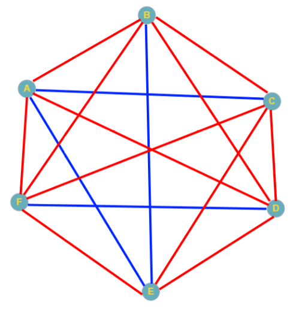

# 1.11 מימוש אלגוריתם השידוך היציב בעזרת פייתון

<div class="video-lecture-block" style="margin: 1.5rem 0; background: #f8fafc; border: 1px solid #e2e8f0; border-radius: 10px; padding: 16px;">
  <div style="display: flex; align-items: center; justify-content: space-between; margin-bottom: 10px; flex-wrap: wrap;">
    <span style="font-weight: 700; color: #1e293b; font-size: 1.05rem;">🎬 הרצאת וידאו: פתרון בעיית השידוך היציב בעזרת פייתון</span>
    <span style="color: #64748b; font-size: 0.85rem;">מרצה: ד"ר אמיר רובינשטיין | אוניברסיטת תל אביב</span>
  </div>
  <div class="video-container" style="position: relative; padding-bottom: 56.25%; height: 0; overflow: hidden; border-radius: 8px; box-shadow: 0 2px 8px rgba(0,0,0,0.1);">
    <iframe 
      src="https://www.youtube-nocookie.com/embed/Ccbh0FtP4M4" 
      title="פתרון בעיית השידוך היציב בעזרת פייתון" 
      style="position: absolute; top: 0; left: 0; width: 100%; height: 100%; border:0;" 
      allow="accelerometer; autoplay; clipboard-write; encrypted-media; gyroscope; picture-in-picture" 
      allowfullscreen>
    </iframe>
  </div>
  <div style="margin-top: 8px; font-size: 0.85rem; color: #64748b; text-align: left; direction: ltr;">
    🔗 <a href="https://www.youtube.com/watch?v=Ccbh0FtP4M4" target="_blank" style="color: #2563eb; text-decoration: none;">Watch on YouTube</a> | 
    <a href="https://www.youtube.com/playlist?list=PLZkJ6lmZSF_ylSMai1DAB1T2nRAK8Q_RA" target="_blank" style="color: #2563eb; text-decoration: none;">TAU Full Course Playlist</a>
  </div>
</div>




> 🎬 **דברי המרצים:**  
> *"ביחידה הקודמת למדנו על האלגוריתם של גייל ושפלי ברמה הרעיונית. כעת, כשיש לנו מושגים ראשונים בפייתון, בואו נראה כיצד מייצגים את הבעיה הזו בקוד פייתון אמיתי. אל תיבהלו מאורך הקוד – נפרק אותו צעד אחר צעד."*

---

## 1. ייצוג נתוני השידוך

כדי לממש את האלגוריתם, עלינו לייצג שני דברים:
1. **רשימות העדפות:** מי מעדיף את מי.
2. **מצב השידוך הנוכחי:** מי משודך למי בכל שלב.

```python
# העדפות הגברים עבור הנשים
men_preferences = {
    "אבי": ["דנה", "מיכל", "רוני"],
    "בני": ["מיכל", "דנה", "רוני"],
    "גדי": ["דנה", "רוני", "מיכל"]
}

# העדפות הנשים עבור הגברים
women_preferences = {
    "דנה": ["בני", "אבי", "גדי"],
    "מיכל": ["אבי", "בני", "גדי"],
    "רוני": ["אבי", "גדי", "בני"]
}
```

---

## 2. הקוד המלא לאלגוריתם Gale-Shapley בפייתון

[](https://colab.research.google.com/github/alonitzkovitch/python_course_book/blob/main/practice/interactive_labs.ipynb)
[](https://kaggle.com/kernels/welcome?src=https://raw.githubusercontent.com/alonitzkovitch/python_course_book/main/practice/interactive_labs.ipynb)


```python
def stable_matching(men_prefs, women_prefs):
    # בהתחלה כל הגברים והנשים פנויים
    free_men = list(men_prefs.keys())
    engagements = {}  # מיפוי אישה -> גבר
    proposals = {man: 0 for man in men_prefs}  # ספירת הצעות לכל גבר

    while free_men:
        man = free_men.pop(0)
        # האישה הבאה ברשימת ההעדפות שלו:
        woman = men_prefs[man][proposals[man]]
        proposals[man] += 1

        if woman not in engagements:
            # האישה פנויה - מתארסים זמנית!
            engagements[woman] = man
        else:
            current_man = engagements[woman]
            woman_pref = women_prefs[woman]
            # אם האישה מעדיפה את הגבר החדש על פני המשודך הנוכחי:
            if woman_pref.index(man) < woman_pref.index(current_man):
                engagements[woman] = man
                free_men.append(current_man)  # המשודך הקודם חוזר לרשימת הפנויים
            else:
                free_men.append(man)  # הגבר החדש נדחה ונשאר פנוי

    return engagements

# הרצת האלגוריתם:
matches = stable_matching(men_preferences, women_preferences)
print("השידוך היציב שנמצא:")
for woman, man in matches.items():
    print(f"{woman} משודכת ל-{man}")
```

---

## ❓ שאלת הבנה

מה מבטיח שהאלגוריתם יסתיים תמיד בשידוך שבו כל המשתתפים נשואים?

<details>
<summary><b>לחצו לצפייה בתשובה והסבר</b></summary>

**תשובה:**  
אישה שהתארסה פעם אחת לעולם אינה חוזרת להיות פנויה – היא יכולה רק "לשדרג" לבן זוג המועדף עליה יותר. מכיוון שמספר הגברים שווה למספר הנשים, לא ייתכן שאישה תישאר רווקה אם יש גבר פנוי שהציע לכולן, ולכן בסיום כל המשתתפים משודכים.
</details>