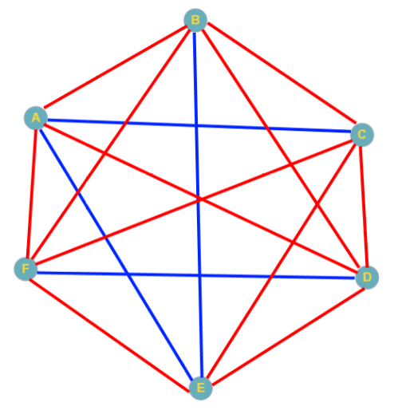

# 1.2 בעיות חישוביות, אלגוריתמים ובעיית השידוך היציב

<div class="video-lecture-block" style="margin: 1.5rem 0; background: #f8fafc; border: 1px solid #e2e8f0; border-radius: 10px; padding: 16px;">
  <div style="display: flex; align-items: center; justify-content: space-between; margin-bottom: 10px; flex-wrap: wrap;">
    <span style="font-weight: 700; color: #1e293b; font-size: 1.05rem;">🎬 הרצאת וידאו: אלגוריתם שידוך יציב (Gale-Shapley)</span>
    <span style="color: #64748b; font-size: 0.85rem;">מרצה: פרופ' בני שור וד"ר אמיר רובינשטיין | אוניברסיטת תל אביב</span>
  </div>
  <div class="video-container" style="position: relative; padding-bottom: 56.25%; height: 0; overflow: hidden; border-radius: 8px; box-shadow: 0 2px 8px rgba(0,0,0,0.1);">
    <iframe 
      src="https://www.youtube-nocookie.com/embed/zLiB9I-SpOs" 
      title="אלגוריתם שידוך יציב (Gale-Shapley)" 
      style="position: absolute; top: 0; left: 0; width: 100%; height: 100%; border:0;" 
      allow="accelerometer; autoplay; clipboard-write; encrypted-media; gyroscope; picture-in-picture" 
      allowfullscreen>
    </iframe>
  </div>
  <div style="margin-top: 8px; font-size: 0.85rem; color: #64748b; text-align: left; direction: ltr;">
    🔗 <a href="https://www.youtube.com/watch?v=zLiB9I-SpOs" target="_blank" style="color: #2563eb; text-decoration: none;">Watch on YouTube</a> | 
    <a href="https://www.youtube.com/playlist?list=PLZkJ6lmZSF_ylSMai1DAB1T2nRAK8Q_RA" target="_blank" style="color: #2563eb; text-decoration: none;">TAU Full Course Playlist</a>
  </div>
</div>




> 🎬 **דברי המרצים:**  
> *"מהו אלגוריתם? זהו מושג שכולם מדברים עליו היום, אבל מה הוא בעצם אומר? אלגוריתם הוא פשוט מתכון מדויק: סדרה של צעדים חד-משמעיים שלוקחים קלט מסוים ומייצרים פלט מבוקש. אחת הדוגמאות היפות ביותר לאלגוריתם אלגנטי היא בעיית השידוך היציב של גייל ושפלי."*

---

## 1. מהי בעיה חישובית ומהו אלגוריתם?

* **בעיה חישובית (Computational Problem):** הגדרה כללית של יחס רצוי בין **קלט (Input)** ל**פלט (Output)**.  
  *לדוגמה:* קלט: רשימת שמות; פלט: אותה רשימה ממוינת לפי סדר הא-ב.
* **אלגוריתם (Algorithm):** סדרה סופית, מוגדרת היטב וחד-משמעית של הוראות לפתרון הבעיה.
* **פסאודו-קוד (Pseudocode):** תיאור מילולי מובנה של האלגוריתם בשפה אנושית, המגשר בין הרעיון המתמטי לבין כתיבת הקוד בפועל.

---

## 2. בעיית השידוך היציב (Stable Matching Problem)

נניח שיש לנו $n$ מועמדים (למשל רופאים סטאז'רים) ו-$n$ בתי חולים. לכל רופא יש דירוג העדפות של בתי החולים, ולכל בית חולים יש דירוג העדפות של הרופאים.

**מטרתנו:** לשדך בין כל רופא לבית חולים כך שהשידוך יהיה **יציב**.

### מהו "זוג בלתי-יציב" (Instability)?
שידוך נחשב **בלתי-יציב** אם קיימים רופא $R$ ובית חולים $H$ שאינם משודכים זה לזה, אבל:
1. הרופא $R$ מעדיף את בית החולים $H$ על פני בית החולים ששודך לו.
2. בית החולים $H$ מעדיף את הרופא $R$ על פני הרופא ששודך לו.

במצב כזה, $R$ ו-$H$ "יברחו" יחד ויפרו את השידוך!

---

## 3. אלגוריתם Gale-Shapley (1962)

דייוויד גייל ולויד שפלי הוכיחו כי **תמיד קיים שידוך יציב**, והציעו אלגוריתם מבריק למציאתו:

```
1. כל עוד יש מועמד שאינו משודך:
   1.1 המועמד מציע נישואין / מועמדות למקום המועדף עליו ביותר שעוד לא דחה אותו.
   1.2 מקום העבודה:
       - אם הוא פנוי: מקבל את ההצעה זמנית.
       - אם הוא כבר משודך: משווה בין השידוך הנוכחי למועמד החדש.
         מחזיק במי שעדיף בעיניו, ודוחה את הפחות מועדף!
2. כאשר כולם משודכים - השידוך מובטח להיות יציב לחלוטין!
```

על פיתוח זה הוענק ללויד שפלי (יחד עם אלווין רות') **פרס נובל לכלכלה לשנת 2012**.

---

## 4. קוד פייתון להמחשת העדפות

[](https://colab.research.google.com/github/alonitzkovitch/python_course_book/blob/main/practice/interactive_labs.ipynb)
[](https://kaggle.com/kernels/welcome?src=https://raw.githubusercontent.com/alonitzkovitch/python_course_book/main/practice/interactive_labs.ipynb)


```python
# דירוגי העדפות לדוגמה של מועמדים
candidates_preferences = {
    "דני": ["איכילוב", "שיבא", "הדסה"],
    "מאיה": ["שיבא", "איכילוב", "הדסה"],
    "עומר": ["שיבא", "הדסה", "איכילוב"]
}

for name, prefs in candidates_preferences.items():
    print(f"העדפות של {name}: המקום המועדף ביותר הוא {prefs[0]}")
```

---

## ❓ שאלת הבנה

מדוע אלגוריתם Gale-Shapley מובטח להסתיים תמיד ולא להיכנס ללולאה אינסופית?

<details>
<summary><b>לחצו לצפייה בתשובה והסבר</b></summary>

**תשובה:**  
בכל צעד של האלגוריתם, מועמד מציע למקום עבודה שעוד לא פנה אליו. מכיוון שמספר המקומות הוא סופי ($n$), ומספר המועמדים הוא סופי ($n$), יש לכל היותר $n 	imes n = n^2$ הצעות אפשריות. ברגע שמועמד נדחה ממקום מסוים, הוא לעולם לא יפנה אליו שוב, ולכן האלגוריתם חייב להסתיים במספר צעדים סופי.
</details>