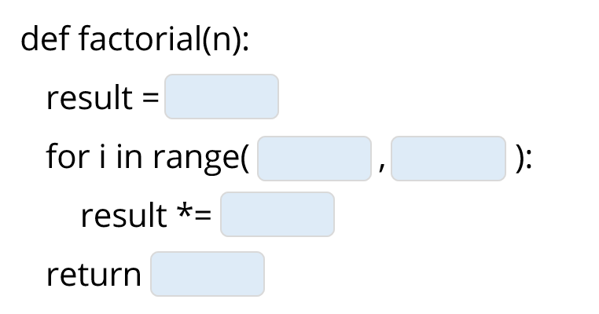

# 1.4 פעולות חשבוניות, חילוק שלם, שארית וחזקה



> 🎬 **דברי המרצים:**  
> *"פייתון יכולה לשמש כמחשבון רב-עוצמה. מעבר לחיבור, חיסור וכפל המוכרים, יש בפייתון שני אופרטורים סודיים וחשובים ביותר שכל מתכנת חייב להכיר: חילוק שלם (`//`) ושארית מודולו (`%`)."*

---

## 1. טבלת האופרטורים החשבוניים

| פעולה | אופרטור | דוגמה בקוד | תוצאה | טיפוס מוחזר | הסבר |
| :--- | :---: | :---: | :---: | :---: | :--- |
| **חיבור** | `+` | `10 + 5` | `15` | `int` | חיבור רגיל |
| **חיסור** | `-` | `10 - 4` | `6` | `int` | חיסור רגיל |
| **כפל** | `*` | `3 * 7` | `21` | `int` | כפל רגיל |
| **חילוק ממשי** | `/` | `12 / 4` | `3.0` | `float` | תמיד מחזיר מספר עם נקודה עשרונית! |
| **חילוק שלם** | `//` | `13 // 4` | `3` | `int` | מעגל כלפי מטה לחלק השלם |
| **שארית (מודולו)** | `%` | `13 % 4` | `1` | `int` | שארית החלוקה |
| **חזקה** | `**` | `2 ** 5` | `32` | `int` | 2 בחזקת 5 ($2^5 = 32$) |

---

## 2. הבנת החילוק השלם (`//`) והשארית (`%`)

כאשר מחלקים 14 ב-4:
$$14 = 3 \times 4 + 2$$
* **החלק השלם (`14 // 4`):** כמה פעמים 4 נכנס בשלמותו ב-14? התשובה היא **3**.
* **השארית (`14 % 4`):** מה נשאר עודף לאחר שלקחנו 3 פעמים 4? התשובה היא **2**.

### שימושים מרכזיים בשארית מודולו (`%`)
1. **בדיקת זוגיות:** מספר הוא זוגי אם ורק אם `num % 2 == 0`.
2. **פירוק זמנים:** המרת 130 שניות לדקות ושניות:
   * דקות: `130 // 60` $	o$ `2` דקות.
   * שניות עודפות: `130 % 60` $	o$ `10` שניות.
3. **מחזוריות מעגלית:** ימי השבוע, שעות בשעון, הצפנת צופן קיסר.

---

## 3. קוד מעשי להרצה

[](https://colab.research.google.com/github/alonitzkovitch/python_course_book/blob/main/practice/interactive_labs.ipynb)
[](https://kaggle.com/kernels/welcome?src=https://raw.githubusercontent.com/alonitzkovitch/python_course_book/main/practice/interactive_labs.ipynb)


```python
total_seconds = 3725

hours = total_seconds // 3600
remaining = total_seconds % 3600
minutes = remaining // 60
seconds = remaining % 60

print(f"{total_seconds} שניות הן: {hours} שעות, {minutes} דקות ו-{seconds} שניות.")
```

---

## ❓ שאלת הבנה

מהי התוצאה של הביטוי הבא?
```python
result = 17 // 5 + 17 % 5
print(result)
```

<details>
<summary><b>לחצו לצפייה בתשובה והסבר</b></summary>

**תשובה:** `5`  
**הסבר:**
* `17 // 5 = 3` (כי $5 	imes 3 = 15$).
* `17 % 5 = 2` (השארית: $17 - 15 = 2$).
* `3 + 2 = 5`.
</details>
