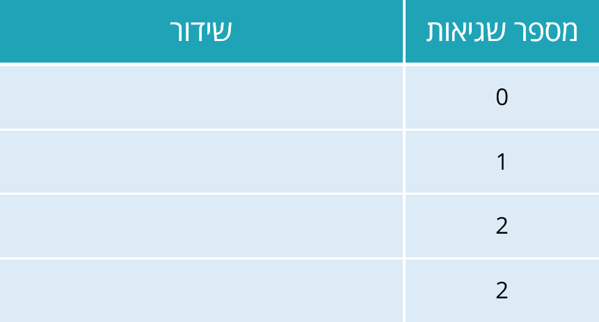

# 1.6 שגיאות בפייתון: תחביר, זמן ריצה ושגיאות לוגיות



> 🎬 **דברי המרצים:**  
> *"אחד הדברים החשובים ביותר שמתכנת מתחיל צריך ללמוד הוא לא לפחד מהודעות שגיאה! שגיאה איננה כישלון – היא המורה הטוב ביותר שלכם. המחשב אינו כועס עליכם; הוא פשוט מסביר לכם בדיוק היכן הוא נתקע ומה דרוש לו כדי להמשיך."*

---

## 1. שלושת סוגי השגיאות בתכנות

### א. שגיאות תחביר (`SyntaxError`)
שגיאה שבה הפרנו את חוקי הדקדוק של שפת פייתון (למשל: סוגר שלא נסגר, מרכאות שלא נסגרו, או מילה שמורה שאויתה שגוי).  
פייתון מזהה שגיאות אלו **עוד לפני שהתוכנית מתחילה לרוץ**!

```python
# SyntaxError: EOL while scanning string literal
# print("שלום)
```

### ב. שגיאות זמן ריצה (`Runtime Errors`)
התחביר תקין לחלוטין, אך בעת ביצוע הפקודה התרחשה פעולה בלתי אפשרית:
* **`ZeroDivisionError`:** ניסיון לחלק במספר 0 (`10 / 0`).
* **`NameError`:** שימוש בשם משתנה שטרם הוגדר (`print(x)` כאשר `x` לא קיים).
* **`TypeError`:** ניסיון לבצע פעולה בין טיפוסים לא מתאימים (למשל חיבור מחרוזת ומספר: `"age: " + 20`).

### ג. שגיאות לוגיות (Logical Bugs)
התוכנית רצה עד סופה מבלי לזרוק שום הודעת שגיאה – אך **התוצאה שהיא מפיקה שגויה**!  
*לדוגמה:* רצינו לחשב ממוצע של שני מספרים וכתבנו `avg = a + b / 2` (במקום `(a + b) / 2`). בגלל קדימות פעולות חשבון, רק `b` יחולק ב-2!

---

## 2. קוד מעשי להרצה

[](https://colab.research.google.com/github/alonitzkovitch/python_course_book/blob/main/practice/interactive_labs.ipynb)
[](https://kaggle.com/kernels/welcome?src=https://raw.githubusercontent.com/alonitzkovitch/python_course_book/main/practice/interactive_labs.ipynb)


```python
# הדגמת המרת טיפוסים (Casting) למניעת TypeError
age = 25

# שגוי: print("גילי הוא: " + age) -> TypeError!
# נכון: ממירים את המספר למחרוזת בעזרת str():
print("גילי הוא: " + str(age))

# או שימוש ב-f-string המודרני:
print(f"גילי הוא: {age}")
```

---

## ❓ שאלת הבנה

איזה סוג שגיאה תתרחש בהרצת הקוד הבא?
```python
width = 10
height = 5
area = width * heigth
```

<details>
<summary><b>לחצו לצפייה בתשובה והסבר</b></summary>

**תשובה:** `NameError: name 'heigth' is not defined`  
**הסבר:** שגיאת כתיב בשם המשתנה (`heigth` במקום `height`). מכיוון שהמשתנה עם השגיאה מעולם לא הוגדר, פייתון תזרוק `NameError`.
</details>
