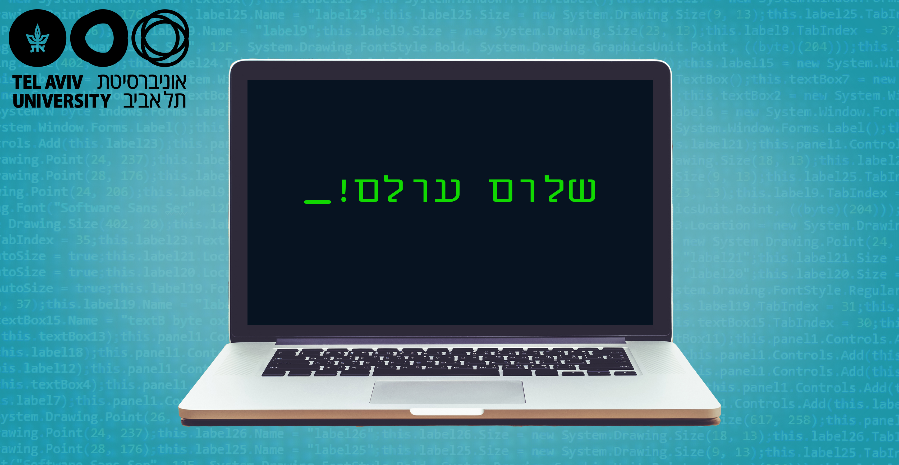

# 1.9 פעולות על מחרוזות – חלק א' (שרשור, שכפול, `len`, `in`)

<div class="video-lecture-block" style="margin: 1.5rem 0; background: #f8fafc; border: 1px solid #e2e8f0; border-radius: 10px; padding: 16px;">
  <div style="display: flex; align-items: center; justify-content: space-between; margin-bottom: 10px; flex-wrap: wrap;">
    <span style="font-weight: 700; color: #1e293b; font-size: 1.05rem;">🎬 הרצאת וידאו: פעולות על מחרוזות - חלק א' (שרשור, שכפול וחיתוך)</span>
    <span style="color: #64748b; font-size: 0.85rem;">מרצה: ד"ר אמיר רובינשטיין | אוניברסיטת תל אביב</span>
  </div>
  <div class="video-container" style="position: relative; padding-bottom: 56.25%; height: 0; overflow: hidden; border-radius: 8px; box-shadow: 0 2px 8px rgba(0,0,0,0.1);">
    <iframe 
      src="https://www.youtube-nocookie.com/embed/Duztef3NaZs" 
      title="פעולות על מחרוזות - חלק א' (שרשור, שכפול וחיתוך)" 
      style="position: absolute; top: 0; left: 0; width: 100%; height: 100%; border:0;" 
      allow="accelerometer; autoplay; clipboard-write; encrypted-media; gyroscope; picture-in-picture" 
      allowfullscreen>
    </iframe>
  </div>
  <div style="margin-top: 8px; font-size: 0.85rem; color: #64748b; text-align: left; direction: ltr;">
    🔗 <a href="https://www.youtube.com/watch?v=Duztef3NaZs" target="_blank" style="color: #2563eb; text-decoration: none;">Watch on YouTube</a> | 
    <a href="https://www.youtube.com/playlist?list=PLZkJ6lmZSF_ylSMai1DAB1T2nRAK8Q_RA" target="_blank" style="color: #2563eb; text-decoration: none;">TAU Full Course Playlist</a>
  </div>
</div>




> 🎬 **דברי המרצים:**  
> *"בדומה לפעולות חשבון על מספרים, פייתון מאפשרת לבצע מגוון פעולות שימושיות על מחרוזות: שרשור (הדבקה), שכפול (כפל), מדידת אורך, ובדיקת שייכות של תת-מחרוזת."*

---

## 1. פעולות בסיסיות על מחרוזות

### א. שרשור מחרוזות (`+`)
האופרטור `+` בין שתי מחרוזות מדביק אותן זו לזו ויוצר מחרוזת חדשה:

```python
first_name = "ישראל"
last_name = "ישראלי"
full_name = first_name + " " + last_name
print(full_name)  # ישראל ישראלי
```

### ב. שכפול מחרוזת (`*`)
הכפלת מחרוזת במספר שלם חיובי $n$ משכפלת את המחרוזת $n$ פעמים ברצף:

```python
cheer = "הידד! " * 3
print(cheer)  # הידד! הידד! הידד! 

line = "-" * 30
print(line)
```

### ג. אורך מחרוזת: הפונקציה `len()`
הפונקציה `len()` מחזירה את מספר התווים הכולל במחרוזת (כולל רווחים וסימני פיסוק):

```python
word = "Python"
print("אורך המילה:", len(word))  # 6

empty = ""
print("אורך מחרוזת ריקה:", len(empty))  # 0
```

### ד. בדיקת שייכות: האופרטור `in`
האופרטור `in` בודק האם תת-מחרוזת מופיעה בתוך מחרוזת אחרת, ומחזיר `True` או `False`:

```python
sentence = "מדעי המחשב באוניברסיטת תל אביב"

print("מדעי" in sentence)   # True
print("ירושלים" in sentence) # False
print(" " in sentence)      # True (רווח קיים במחרוזת)
```

---

## 2. קוד מעשי להרצה

[](https://colab.research.google.com/github/alonitzkovitch/python_course_book/blob/main/practice/interactive_labs.ipynb)
[](https://kaggle.com/kernels/welcome?src=https://raw.githubusercontent.com/alonitzkovitch/python_course_book/main/practice/interactive_labs.ipynb)


```python
dna = "ACTGATTGCATAGCG"
sub = "TGAT"

if sub in dna:
    print(f"הרצף {sub} נמצא בתוך ה-DNA באורך {len(dna)} בסיסים!")
```

---

## ❓ שאלת הבנה

מה יהיה ערכו של הביטוי `len("ab" * 4)`?

<details>
<summary><b>לחצו לצפייה בתשובה והסבר</b></summary>

**תשובה:** `8`  
**הסבר:** `"ab" * 4` מייצר את המחרוזת `"abababab"`, המכילה בדיוק 8 תווים.
</details>