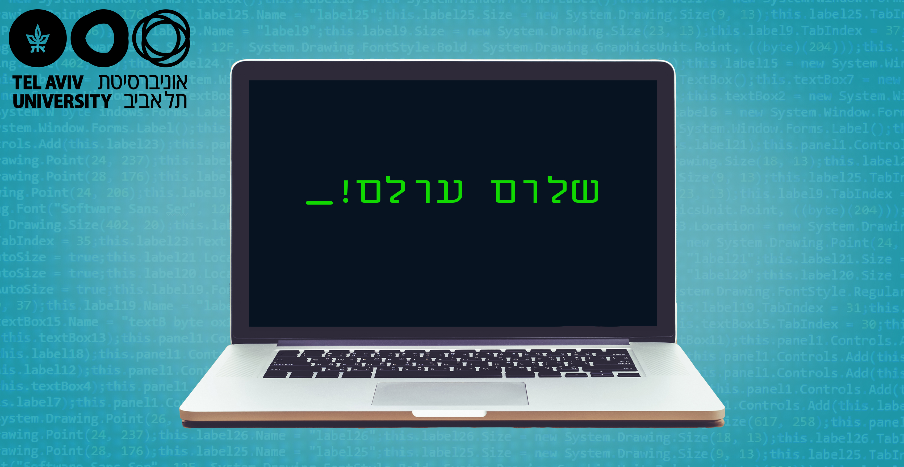

# שיעור 1: מדעי המחשב ושפת פייתון - נעים להכיר!

> **"מדעי המחשב עוסקים במחשבים באותה מידה שאסטרונומיה עוסקת בטלסקופים."**  
> — אדסחר דייקסטרה

ברוכים הבאים לשיעור הראשון בקורס! בשיעור זה נצלול אל יסודות עולם המחשוב, נבין כיצד מידע מיוצג בזיכרון המחשב, ונכתוב את שורות הקוד הראשונות שלנו בשפת Python.

---

### ⏱️ יחידות הלימוד לפי סדר הקורס בקמפוס IL:
1. **[1.1 מהם מדעי המחשב? (חומרה, תוכנה והשיטה הבינארית)](1_intro_cs.md)**
2. **[1.2 בעיות חישוביות, אלגוריתמים ובעיית השידוך היציב (Gale-Shapley)](2_algorithms_gale_shapley.md)**
3. **[1.3 היכרות ראשונה עם פייתון: הדפסות (`print`) והערות (`#`)](3_python_basics_print.md)**
4. **[1.4 פעולות חשבוניות, חילוק שלם, שארית וחזקה](4_arithmetic_operators.md)**
5. **[1.5 טיפוסי נתונים בסיסיים, פונקציית `type()`, משתנים והשמה (`=`)](5_types_and_variables.md)**
6. **[1.6 שגיאות בפייתון: תחביר, זמן ריצה ושגיאות לוגיות](6_errors_in_python.md)**
7. **[1.7 השוואות מספרים ואופרטורים בוליאניים](7_comparisons.md)**
8. **[1.8 מחרוזות בפייתון: הגדרה, תווים ומבנה](8_strings_intro.md)**
9. **[1.9 פעולות על מחרוזות – חלק א' (שרשור, שכפול, `len`, `in`)](9_strings_operations_1.md)**
10. **[1.10 פעולות על מחרוזות – חלק ב' (אינדקסים, סדר לקסיקוגרפי וחריגות)](10_strings_operations_2.md)**
11. **[1.11 פתרון בעיית השידוך היציב בעזרת פייתון](11_gale_shapley_python.md)**
12. **[1.12 סיכום שיעור 1, שאלות מעקב ותרגול אינטראקטיבי](12_lesson1_summary_quiz.md)**
