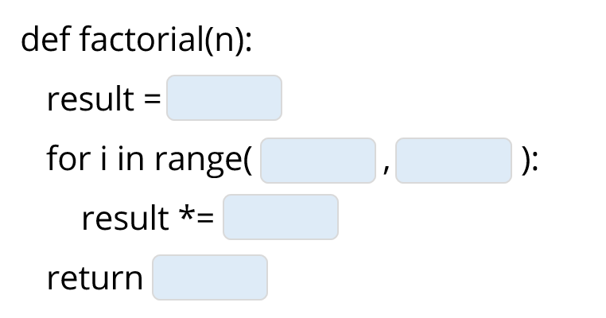

# 2.4 משפטי תנאי – חלק א' (`if-else`, הזחות וקשרים לוגיים)

<div class="video-lecture-block" style="margin: 1.5rem 0; background: #f8fafc; border: 1px solid #e2e8f0; border-radius: 10px; padding: 16px;">
  <div style="display: flex; align-items: center; justify-content: space-between; margin-bottom: 10px; flex-wrap: wrap;">
    <span style="font-weight: 700; color: #1e293b; font-size: 1.05rem;">🎬 הרצאת וידאו: משפטי תנאי ופונקציות בפייתון</span>
    <span style="color: #64748b; font-size: 0.85rem;">מרצה: ד"ר אמיר רובינשטיין | אוניברסיטת תל אביב</span>
  </div>
  <div class="video-container" style="position: relative; padding-bottom: 56.25%; height: 0; overflow: hidden; border-radius: 8px; box-shadow: 0 2px 8px rgba(0,0,0,0.1);">
    <iframe 
      src="https://www.youtube-nocookie.com/embed/VvgsCft7XpY" 
      title="משפטי תנאי ופונקציות בפייתון" 
      style="position: absolute; top: 0; left: 0; width: 100%; height: 100%; border:0;" 
      allow="accelerometer; autoplay; clipboard-write; encrypted-media; gyroscope; picture-in-picture" 
      allowfullscreen>
    </iframe>
  </div>
  <div style="margin-top: 8px; font-size: 0.85rem; color: #64748b; text-align: left; direction: ltr;">
    🔗 <a href="https://www.youtube.com/watch?v=VvgsCft7XpY" target="_blank" style="color: #2563eb; text-decoration: none;">Watch on YouTube</a> | 
    <a href="https://www.youtube.com/playlist?list=PLZkJ6lmZSF_ylSMai1DAB1T2nRAK8Q_RA" target="_blank" style="color: #2563eb; text-decoration: none;">TAU Full Course Playlist</a>
  </div>
</div>




> 🎬 **דברי המרצים:**  
> *"תוכנית מחשב שרצה שורה אחרי שורה בצורה עיוורת היא מוגבלת מאוד. כדי שהמחשב יוכל להתנהג בצורה חכמה, עלינו לאפשר לו לקבל החלטות: 'אם התנאי מתקיים – עשה א', אחרת – עשה ב'."*

---

## 1. המבנה הבסיסי: `if` ו-`else`

```python
temperature = 38.2

if temperature > 37.5:
    print("יש לך חום! מומלץ לנוח.")
else:
    print("חום הגוף תקין, המשך ביומך כרגיל.")
```

### חוקי התחביר החיוניים של פייתון
1. **נקודתיים (`:`):** שורת ה-`if` ושורת ה-`else` **חייבות להסתיים תמיד בנקודתיים**.
2. **הזחה (Indentation):** כל הפקודות השייכות לגוף התנאי **חייבות להיות מוזחות ימינה** (בדיוק 4 רווחים או לחיצה על מקש `Tab`).
3. ברגע שההזחה חוזרת שמאלה, פייתון מבינה שמשפט התנאי הסתיים!

---

## 2. קשרים לוגיים: `and`, `or`, `not`

ניתן לחבר מספר תנאים יחד:
* **`and` (וגם):** הביטוי מתקיים רק אם **שני** התנאים הם `True`.
* **`or` (או):** הביטוי מתקיים אם **לפחות אחד** מהתנאים הוא `True`.
* **`not` (שלילה):** הופך `True` ל-`False`, ולהיפך.

```python
age = 22
has_ticket = True

if age >= 18 and has_ticket:
    print("ברוך הבא לאירוע!")
```

---

## 3. קוד מעשי להרצה

[](https://colab.research.google.com/github/alonitzkovitch/python_course_book/blob/main/practice/interactive_labs.ipynb)
[](https://kaggle.com/kernels/welcome?src=https://raw.githubusercontent.com/alonitzkovitch/python_course_book/main/practice/interactive_labs.ipynb)


```python
# בדיקת קבלה למלגה: ציון מעל 90 או פעילות התנדבותית
grade = 88
volunteered = True

if grade >= 90 or volunteered:
    print("מזל טוב! אתה זכאי להגיש מועמדות למלגה.")
else:
    print("לצערנו אינך עומד בקריטריונים.")
```

---

## ❓ שאלת הבנה

מה יודפס בהרצת הקוד הבא?
```python
x = 5
if x > 10:
    print("A")
print("B")
```

<details>
<summary><b>לחצו לצפייה בתשובה והסבר</b></summary>

**פלט:**
```text
B
```
**הסבר:** התנאי `x > 10` הוא `False`, ולכן `"A"` לא יודפס. הפקודה `print("B")` אינה מוזחת, ולכן אינה שייכת ל-`if` ותודפס תמיד!
</details>