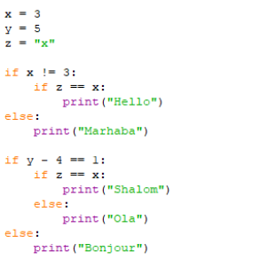

# 2.6 הגדרת פונקציות (`def`, חתימה, `return` מול `print`)



> 🎬 **דברי המרצים:**  
> *"פונקציה היא אחת ההמצאות החשובות ביותר בתולדות התוכנה. במקום לכתוב את אותו קוד שוב ושוב, אנחנו אורזים אותו בקופסה בעלת שם, קובעים מה הקלטים שלה ומה היא מחזירה, ומשתמשים בה בכל מקום שנרצה!"*

---

## 1. תחביר הגדרת פונקציה: `def`

פונקציה מוגדרת באמצעות מילת המפתח `def`:

```python
def calculate_rectangle_area(width, height):
    """פונקציה המחשבת ומחזירה שטח מלבן"""
    area = width * height
    return area
```

* **`def`:** מצהירה על הגדרת פונקציה חדשה.
* **שם הפונקציה:** `calculate_rectangle_area`.
* **חתימת הפונקציה (סוגריים):** הפרמטרים שהפונקציה מקבלת (`width, height`).
* **`return`:** פקודת ההחזרה המעבירה את התוצאה החישובית בחזרה למי שקרא לפונקציה.

---

## 2. ההבדל הקריטי: `return` מול `print()`

:::{warning} מלכודת הנפוצה ביותר של מתחילים!
* **`print()`** רק מציג טקסט על המסך למשתמש. המחשב **אינו יכול** להשתמש בפלט זה להמשך חישובים!
* **`return`** מחזיר ערך לתוך ביטוי, כך שניתן לשמור אותו במשתנה או להעבירו לפונקציה אחרת.
פונקציה שאין בה `return` מחזירה כברירת מחדל את הערך המיוחד **`None`**.
:::

```python
def add_with_return(a, b):
    return a + b

def add_with_print(a, b):
    print(a + b)

res1 = add_with_return(3, 4)
res2 = add_with_print(3, 4)

print("res1 כפול 2:", res1 * 2)  # 14 (עובד מצוין!)
# print(res2 * 2)  # קורס! TypeError: unsupported operand for NoneType
```

---

## 3. קוד מעשי להרצה

[](https://colab.research.google.com/github/alonitzkovitch/python_course_book/blob/main/practice/interactive_labs.ipynb)
[](https://kaggle.com/kernels/welcome?src=https://raw.githubusercontent.com/alonitzkovitch/python_course_book/main/practice/interactive_labs.ipynb)


```python
def is_even(n):
    """מחזירה True אם המספר זוגי, אחרת False"""
    return n % 2 == 0

print("האם 14 זוגי?", is_even(14))  # True
print("האם 7 זוגי?", is_even(7))    # False
```

---

## ❓ שאלת הבנה

מה יהיה ערכו של `ans` לאחר השורה הבאה?
```python
def greet(name):
    print("שלום", name)

ans = greet("מיכל")
print(ans)
```

<details>
<summary><b>לחצו לצפייה בתשובה והסבר</b></summary>

**תשובה:** `None`  
**הסבר:** הפונקציה `greet` מבצעת `print` אך אינה כוללת פקודת `return`. בפייתון, פונקציה ללא `return` מחזירה תמיד `None`.
</details>
