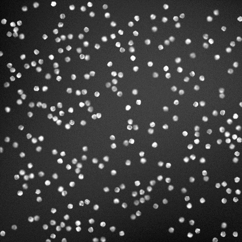

# 3.1 למה לולאות? בעיית חקר 75,000 החלבונים

<div class="video-lecture-block" style="margin: 1.5rem 0; background: #f8fafc; border: 1px solid #e2e8f0; border-radius: 10px; padding: 16px;">
  <div style="display: flex; align-items: center; justify-content: space-between; margin-bottom: 10px; flex-wrap: wrap;">
    <span style="font-weight: 700; color: #1e293b; font-size: 1.05rem;">🎬 הרצאת וידאו: לולאות בפייתון ומשחק 7-בום</span>
    <span style="color: #64748b; font-size: 0.85rem;">מרצה: ד"ר אמיר רובינשטיין | אוניברסיטת תל אביב</span>
  </div>
  <div class="video-container" style="position: relative; padding-bottom: 56.25%; height: 0; overflow: hidden; border-radius: 8px; box-shadow: 0 2px 8px rgba(0,0,0,0.1);">
    <iframe 
      src="https://www.youtube-nocookie.com/embed/LaRoaZm5GmE" 
      title="לולאות בפייתון ומשחק 7-בום" 
      style="position: absolute; top: 0; left: 0; width: 100%; height: 100%; border:0;" 
      allow="accelerometer; autoplay; clipboard-write; encrypted-media; gyroscope; picture-in-picture" 
      allowfullscreen>
    </iframe>
  </div>
  <div style="margin-top: 8px; font-size: 0.85rem; color: #64748b; text-align: left; direction: ltr;">
    🔗 <a href="https://www.youtube.com/watch?v=LaRoaZm5GmE" target="_blank" style="color: #2563eb; text-decoration: none;">Watch on YouTube</a> | 
    <a href="https://www.youtube.com/playlist?list=PLZkJ6lmZSF_ylSMai1DAB1T2nRAK8Q_RA" target="_blank" style="color: #2563eb; text-decoration: none;">TAU Full Course Playlist</a>
  </div>
</div>




> 🎬 **דברי המרצים וחוקרי מדעי החיים (ד"ר מארק, ד"ר רותם וד"ר אמיר):**  
> *"עד עכשיו למדנו מושגים חשובים: מחרוזות, רשימות, תנאים ופונקציות. היום נלמד על כלי חזק שישרת אותנו לעיתים קרובות: לולאות. כדי להבין את הכוח שבלולאות, בואו נדמיין מחקר אמיתי בביולוגיה חישובית: קיבלנו רשימה של 75,000 חלבונים אנושיים, ואנו רוצים לאתר מתוכם רק את 'החלבונים הגדולים' שאורכם עולה על 1,000 חומצות אמינו. איך נעשה זאת בלי לחזור על שורת הקוד 75,000 פעמים?"*

---

## 1. המגבלה האנושית מול העוצמה של המחשב

לבחון חלבון בודד זה פשוט מאוד בעזרת תנאי שכבר למדנו:

```python
protein = "MKVLYANKP..."  # רצף חומצות אמינו
if len(protein) > 1000:
    print("זהו חלבון גדול!")
```

אבל אם יש לנו רשימה של 75,000 חלבונים:
* לכתוב את שורות ה-`if` בידיים ייקח שבועות של עבודה סיזיפית.
* מספיק שנטעה באחד האינדקסים כדי שכל המחקר ישתבש.

**לולאות (Loops)** מאפשרות לנו לכתוב את הוראת הבדיקה **פעם אחת בלבד**, ולהורות למחשב לבצע אותה על כל 75,000 החלבונים ברצף בתוך פחות משנייה אחת!

---

## 2. קוד מעשי להרצה

[](https://colab.research.google.com/github/alonitzkovitch/python_course_book/blob/main/practice/interactive_labs.ipynb)
[](https://kaggle.com/kernels/welcome?src=https://raw.githubusercontent.com/alonitzkovitch/python_course_book/main/practice/interactive_labs.ipynb)


```python
# הדגמה מוקטנת: סינון רשימת חלבונים
sample_proteins = [
    "MKVLYA",  # אורך 6
    "M" * 1200,  # אורך 1200 - חלבון גדול!
    "ACDEFGHIKLMNPQRSTVWY" * 10,  # אורך 200
    "L" * 3500   # אורך 3500 - חלבון ענק!
]

big_proteins = []
for p in sample_proteins:
    if len(p) > 1000:
        big_proteins.append(len(p))

print(f"נמצאו {len(big_proteins)} חלבונים גדולים באורכים: {big_proteins}")
```

---

## ❓ שאלת הבנה

מה היתרון המרכזי של שימוש בלולאה על פני כתיבה חוזרת של פקודות?

<details>
<summary><b>לחצו לצפייה בתשובה והסבר</b></summary>

**תשובה:**  
לולאה הופכת את הקוד לקצר, קריא וקל לתחזוקה, מונעת טעויות אנוש של העתקה-הדבקה, ומסוגלת לפעול על קלטים בכל גודל (מעשרה פריטים ועד מיליארדי רשומות) מבלי לשנות את שורות הקוד!
</details>