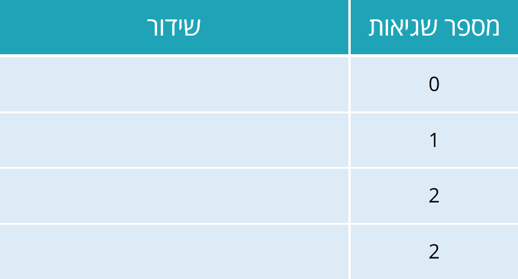

# 3.5 לולאות אינסופיות וכיצד להימנע מהן



> 🎬 **דברי המרצים:**  
> *"הסיוט של כל מתכנת הוא לולאה אינסופית: תוכנית שנכנסת למעגל סגור שלעולם אינו מסתיים, ומנצלת 100% ממשאבי המעבד. חשוב לדעת כיצד לזהות אותן וכיצד להבטיח שתנאי העצירה יתקיים תמיד."*

---

## 1. כיצד נוצרת לולאה אינסופית?

לולאה אינסופית מתרחשת כאשר **תנאי הלולאה לעולם אינו משתנה ל-`False`**:

1. **שכחת עדכון המשתנה:**
   ```python
   # שגוי - i נשאר 0 לנצח!
   # i = 0
   # while i < 5:
   #     print("שלום")
   ```
2. **עדכון בכיוון ההפוך:**
   ```python
   # שגוי - i רק גדל ולכן תמיד יהיה גדול מ-0!
   # i = 1
   # while i > 0:
   #     i += 1
   ```

:::{tip} איך עוצרים תוכנית שנתקעה?
בסביבת טרמינל או Jupyter, לחצו על המקשים `Ctrl + C` (או על כפתור Stop / Interrupt) כדי לקטוע את פעולת המעבד.
:::

---

## 2. קוד מעשי להרצה: שימוש ב-`break` לבטיחות

[](https://colab.research.google.com/github/alonitzkovitch/python_course_book/blob/main/practice/interactive_labs.ipynb)
[](https://kaggle.com/kernels/welcome?src=https://raw.githubusercontent.com/alonitzkovitch/python_course_book/main/practice/interactive_labs.ipynb)


```python
# חיפוש חלוקה עם מנגנון הגבלת צעדים מקסימלי (Safety Guard)
n = 997
divisor = 2
max_steps = 1000
steps = 0

while divisor < n:
    if n % divisor == 0:
        print(f"מצאנו מחלק: {divisor}")
        break
    divisor += 1
    steps += 1
    if steps >= max_steps:
        print("הגענו להגבלת הצעדים המקסימלית!")
        break
else:
    print(f"{n} הוא מספר ראשוני!")
```

---

## ❓ שאלת הבנה

איזה מהתנאים הבאים עלול לגרום ללולאה אינסופית אם `x = 5` ואין שינוי ל-`x` בגוף הלולאה?
* א. `while x == 0:`
* ב. `while x > 0:`
* ג. `while x < 2:`

<details>
<summary><b>לחצו לצפייה בתשובה והסבר</b></summary>

**תשובה נכונה:** **ב** (`while x > 0:`)  
**הסבר:** מכיוון ש-$5 > 0$ הוא `True`, ואם `x` אינו משתנה בגוף הלולאה, התנאי יישאר `True` לנצח!
</details>
