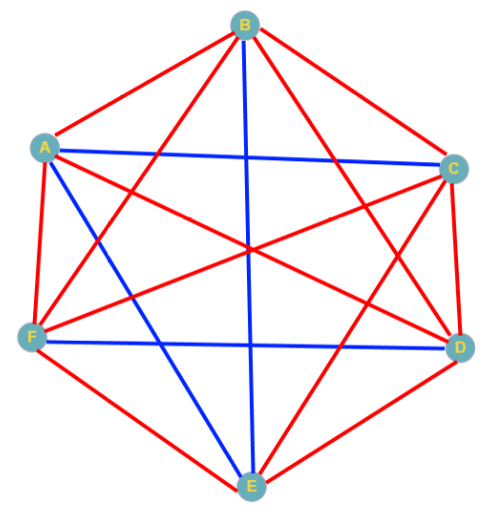

# 3.8 מספרים ראשוניים ואלגוריתמי בדיקה

<div class="video-lecture-block" style="margin: 1.5rem 0; background: #f8fafc; border: 1px solid #e2e8f0; border-radius: 10px; padding: 16px;">
  <div style="display: flex; align-items: center; justify-content: space-between; margin-bottom: 10px; flex-wrap: wrap;">
    <span style="font-weight: 700; color: #1e293b; font-size: 1.05rem;">🎬 הרצאת וידאו: מספרים ראשוניים ואלגוריתמיקה</span>
    <span style="color: #64748b; font-size: 0.85rem;">מרצה: פרופ' בני שור ז"ל | אוניברסיטת תל אביב</span>
  </div>
  <div class="video-container" style="position: relative; padding-bottom: 56.25%; height: 0; overflow: hidden; border-radius: 8px; box-shadow: 0 2px 8px rgba(0,0,0,0.1);">
    <iframe 
      src="https://www.youtube-nocookie.com/embed/TAeXZKeD-jo" 
      title="מספרים ראשוניים ואלגוריתמיקה" 
      style="position: absolute; top: 0; left: 0; width: 100%; height: 100%; border:0;" 
      allow="accelerometer; autoplay; clipboard-write; encrypted-media; gyroscope; picture-in-picture" 
      allowfullscreen>
    </iframe>
  </div>
  <div style="margin-top: 8px; font-size: 0.85rem; color: #64748b; text-align: left; direction: ltr;">
    🔗 <a href="https://www.youtube.com/watch?v=TAeXZKeD-jo" target="_blank" style="color: #2563eb; text-decoration: none;">Watch on YouTube</a> | 
    <a href="https://www.youtube.com/playlist?list=PLZkJ6lmZSF_ylSMai1DAB1T2nRAK8Q_RA" target="_blank" style="color: #2563eb; text-decoration: none;">TAU Full Course Playlist</a>
  </div>
</div>




> 🎬 **דברי המרצים (ד"ר אמיר רובינשטיין ופרופ' בני שור):**  
> *"אחד התחומים האהובים על בני שור ז"ל היה מספרים ראשוניים. מספרים ראשוניים הם 'אבני הבניין' של כל המספרים השלמים, והם מהווים את הבסיס לכל מערכות ההצפנה ואבטחת המידע המודרניות באינטרנט."*

---

## 1. מהו מספר ראשוני?

מספר שלם $p > 1$ נקרא **ראשוני** אם הוא מתחלק ללא שארית אך ורק ב-1 ובעצמו (למשל: $2, 3, 5, 7, 11, 13, 17, 19, 23$).  
מספר שאינו ראשוני נקרא **מספר פריק** (למשל: $4 = 2 \times 2$, $9 = 3 \times 3$).

---

## 2. אלגוריתם ראשוני לבדיקת ראשוניות

[](https://colab.research.google.com/github/alonitzkovitch/python_course_book/blob/main/practice/interactive_labs.ipynb)
[](https://kaggle.com/kernels/welcome?src=https://raw.githubusercontent.com/alonitzkovitch/python_course_book/main/practice/interactive_labs.ipynb)


כדי לבדוק האם $n$ ראשוני, נבדוק האם קיים מספר $d$ בין $2$ ל-$n-1$ שמחלק את $n$ ללא שארית:

```python
def is_prime(n):
    if n <= 1:
        return False
    # בדיקת כל המחלקים האפשריים עד שורש n
    for d in range(2, int(n ** 0.5) + 1):
        if n % d == 0:
            return False  # מצאנו מחלק - אינו ראשוני!
    return True

print("האם 29 ראשוני?", is_prime(29))  # True
print("האם 35 ראשוני?", is_prime(35))  # False (5*7)
```

:::{tip} אופטימיזציית שורש $n$
אם למספר יש מחלק, לפחות אחד המחלקים חייב להיות קטן או שווה ל-$\sqrt{n}$. בדיקה זו מקצרת את זמן הריצה מ-$O(n)$ ל-$O(\sqrt{n})$ – הבדל עצום במספרים גדולים!
:::

---

## ❓ שאלת הבנה

מהו המספר הראשוני הזוגי היחיד שקיים?

<details>
<summary><b>לחצו לצפייה בתשובה והסבר</b></summary>

**תשובה:** `2`  
**הסבר:** כל מספר זוגי אחר גדול מ-2 מתחלק ב-2, ולכן הוא פריק בהגדרה. המספר 2 מתחלק רק ב-1 ובעצמו, ולכן הוא ראשוני.
</details>