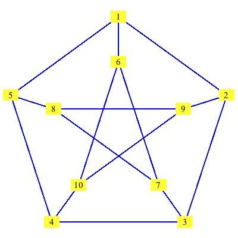

# 6.3 גרף קווי (`plt.plot`) וגרף פיזור (`plt.scatter`)

<div class="video-lecture-block" style="margin: 1.5rem 0; background: #f8fafc; border: 1px solid #e2e8f0; border-radius: 10px; padding: 16px;">
  <div style="display: flex; align-items: center; justify-content: space-between; margin-bottom: 10px; flex-wrap: wrap;">
    <span style="font-weight: 700; color: #1e293b; font-size: 1.05rem;">🎬 הרצאת וידאו: גרף פיזור (Scatter Plot) ואיורים ב-Matplotlib</span>
    <span style="color: #64748b; font-size: 0.85rem;">מרצה: צוות ההוראה | אוניברסיטת תל אביב</span>
  </div>
  <div class="video-container" style="position: relative; padding-bottom: 56.25%; height: 0; overflow: hidden; border-radius: 8px; box-shadow: 0 2px 8px rgba(0,0,0,0.1);">
    <iframe 
      src="https://www.youtube-nocookie.com/embed/HbYmcgS6b8Y" 
      title="גרף פיזור (Scatter Plot) ואיורים ב-Matplotlib" 
      style="position: absolute; top: 0; left: 0; width: 100%; height: 100%; border:0;" 
      allow="accelerometer; autoplay; clipboard-write; encrypted-media; gyroscope; picture-in-picture" 
      allowfullscreen>
    </iframe>
  </div>
  <div style="margin-top: 8px; font-size: 0.85rem; color: #64748b; text-align: left; direction: ltr;">
    🔗 <a href="https://www.youtube.com/watch?v=HbYmcgS6b8Y" target="_blank" style="color: #2563eb; text-decoration: none;">Watch on YouTube</a> | 
    <a href="https://www.youtube.com/playlist?list=PLZkJ6lmZSF_ylSMai1DAB1T2nRAK8Q_RA" target="_blank" style="color: #2563eb; text-decoration: none;">TAU Full Course Playlist</a>
  </div>
</div>




> 🎬 **דברי המרצים:**  
> *"מתי נבחר בגרף קווי ומתי בגרף פיזור? גרף קווי מתאים כאשר הנתונים מייצגים תהליך רציף לאורך זמן. גרף פיזור (Scatter Plot) מתאים כאשר אנו רוצים לבדוק האם קיים קשר או מתאם בין שני משתנים שונים."*

---

## 1. גרף פיזור (Scatter Plot)

```python
import matplotlib.pyplot as plt

# בדיקת קשר בין שעות לימוד לציון בבחינה
study_hours = [2, 5, 8, 10, 12, 15, 3, 7, 11]
grades = [60, 72, 85, 88, 95, 98, 65, 80, 92]

plt.figure(figsize=(7, 4))
plt.scatter(study_hours, grades, color='purple', s=60, alpha=0.8)
plt.title("קשר בין שעות לימוד לציון בבחינה")
plt.xlabel("שעות לימוד שבועיות")
plt.ylabel("ציון בחינה")
plt.grid(True)
plt.show()
```

---

## 2. קוד מעשי להרצה

[](https://colab.research.google.com/github/alonitzkovitch/python_course_book/blob/main/practice/interactive_labs.ipynb)
[](https://kaggle.com/kernels/welcome?src=https://raw.githubusercontent.com/alonitzkovitch/python_course_book/main/practice/interactive_labs.ipynb)


```python
import matplotlib.pyplot as plt

x = range(1, 11)
y = [i ** 2 for i in x]

plt.figure(figsize=(6, 3.5))
plt.scatter(x, y, color='red', label="נקודות מדידה")
plt.plot(x, y, color='blue', linestyle='--', label="קו מגמה")
plt.legend()
plt.show()
```

---

## ❓ שאלת הבנה

מה משמעותו של הפרמטר `alpha=0.7` בפונקציות הציור?

<details>
<summary><b>לחצו לצפייה בתשובה והסבר</b></summary>

**תשובה:** רמת השקיפות של הנקודות או הקו (בין 0 שקוף לגמרי ל-1 אטום לחלוטין), ומסייע לראות נקודות שחופפות זו על גבי זו.
</details>