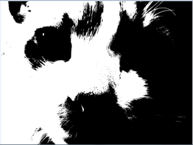

# 7.2 רמות אפור (8 ביטים, 0-255) מול צבעי RGB (24 ביטים)

> 🎬 **דברי המרצים:**  
> *"בתמונת גווני אפור, כל פיקסל נשמר בדיוק בבייט אחד של זיכרון – 8 ביטים, מה שמאפשר לייצג 256 ערכים מ-0 (שחור) ועד 255 (לבן). בתמונת צבע, אנו זקוקים ל-3 בייטים עבור אדום, ירוק וכחול."*

---

## 1. תמונת רמות אפור (Grayscale - פורמט `'L'`)

* **0:** שחור מוחלט.
* **255:** לבן מוחלט.
* **1 עד 254:** 254 גווני אפור שונים.
* **צריכת זיכרון:** 1 בייט לכל פיקסל.

---

## 2. תמונת צבע (RGB)

כל פיקסל מורכב משלושה ערוצי צבע (Red, Green, Blue), כל אחד בין 0 ל-255:
* שחור: `(0, 0, 0)`
* לבן: `(255, 255, 255)`
* אדום טהור: `(255, 0, 0)`
* **צריכת זיכרון:** 3 בייטים לכל פיקסל.

---

## ❓ שאלת הבנה

כמה בייטים של זיכרון דרושים לשמירת תמונת צבע RGB בגודל $1000 \times 800$ פיקסלים ללא דחיסה?

<b>לחצו לצפייה בתשובה והסבר</b>

**תשובה:** `2,400,000` בייטים (כ-2.29 מגה-בייט)  
**הסבר:** $1000 \times 800 = 800,000$ פיקסלים. כפול 3 בייטים לכל פיקסל = $2,400,000$ בייטים.

