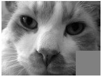

# 7.3 ספריית PIL (Pillow): פתיחה, מימדים `.size` והמרת גוונים

<div class="video-lecture-block" style="margin: 1.5rem 0; background: #f8fafc; border: 1px solid #e2e8f0; border-radius: 10px; padding: 16px;">
  <div style="display: flex; align-items: center; justify-content: space-between; margin-bottom: 10px; flex-wrap: wrap;">
    <span style="font-weight: 700; color: #1e293b; font-size: 1.05rem;">🎬 הרצאת וידאו: עיבוד תמונה בסיסי עם ספריית PIL (חלק א')</span>
    <span style="color: #64748b; font-size: 0.85rem;">מרצה: ד"ר אמיר רובינשטיין | אוניברסיטת תל אביב</span>
  </div>
  <div class="video-container" style="position: relative; padding-bottom: 56.25%; height: 0; overflow: hidden; border-radius: 8px; box-shadow: 0 2px 8px rgba(0,0,0,0.1);">
    <iframe 
      src="https://www.youtube-nocookie.com/embed/BcdvYjgBJnU" 
      title="עיבוד תמונה בסיסי עם ספריית PIL (חלק א')" 
      style="position: absolute; top: 0; left: 0; width: 100%; height: 100%; border:0;" 
      allow="accelerometer; autoplay; clipboard-write; encrypted-media; gyroscope; picture-in-picture" 
      allowfullscreen>
    </iframe>
  </div>
  <div style="margin-top: 8px; font-size: 0.85rem; color: #64748b; text-align: left; direction: ltr;">
    🔗 <a href="https://www.youtube.com/watch?v=BcdvYjgBJnU" target="_blank" style="color: #2563eb; text-decoration: none;">Watch on YouTube</a> | 
    <a href="https://www.youtube.com/playlist?list=PLZkJ6lmZSF_ylSMai1DAB1T2nRAK8Q_RA" target="_blank" style="color: #2563eb; text-decoration: none;">TAU Full Course Playlist</a>
  </div>
</div>




> 🎬 **דברי המרצים:**  
> *"בפייתון נשתמש בספריית עיבוד התמונה המובילה PIL (Pillow). נפתח תמונה, נבדוק את מימדיה ונמיר אותה לגווני אפור."*

---

## 1. טעינה והמרה בספריית PIL

[](https://colab.research.google.com/github/alonitzkovitch/python_course_book/blob/main/practice/interactive_labs.ipynb)
[](https://kaggle.com/kernels/welcome?src=https://raw.githubusercontent.com/alonitzkovitch/python_course_book/main/practice/interactive_labs.ipynb)


```python
from PIL import Image

# פתיחת תמונה
img = Image.open("images/gray_quare_cat.JPG")

# מימדי התמונה (רוחב וגובה)
w, h = img.size
print(f"מימדי התמונה: רוחב={w}, גובה={h} פיקסלים")

# המרה לרמות אפור (פורמט 'L')
gray_img = img.convert('L')
```

---

## ❓ שאלת הבנה

מדוע אחרי `img.size` אין סוגריים `()` כמו אחרי פונקציות רגילות?

<details>
<summary><b>לחצו לצפייה בתשובה והסבר</b></summary>

**תשובה:** `size` אינה פונקציה אלא **תכונה (Attribute / Field)** של אובייקט התמונה המכילה טאפל `(width, height)`.
</details>