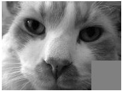

# 7.6 אלגוריתמי מראה, תשליל (Negative), חיתוך וסיבוב

<div class="video-lecture-block" style="margin: 1.5rem 0; background: #f8fafc; border: 1px solid #e2e8f0; border-radius: 10px; padding: 16px;">
  <div style="display: flex; align-items: center; justify-content: space-between; margin-bottom: 10px; flex-wrap: wrap;">
    <span style="font-weight: 700; color: #1e293b; font-size: 1.05rem;">🎬 הרצאת וידאו: עיבוד תמונה מתקדם עם PIL (חלק ב')</span>
    <span style="color: #64748b; font-size: 0.85rem;">מרצה: ד"ר אמיר רובינשטיין | אוניברסיטת תל אביב</span>
  </div>
  <div class="video-container" style="position: relative; padding-bottom: 56.25%; height: 0; overflow: hidden; border-radius: 8px; box-shadow: 0 2px 8px rgba(0,0,0,0.1);">
    <iframe 
      src="https://www.youtube-nocookie.com/embed/HLYZuIY2uaQ" 
      title="עיבוד תמונה מתקדם עם PIL (חלק ב')" 
      style="position: absolute; top: 0; left: 0; width: 100%; height: 100%; border:0;" 
      allow="accelerometer; autoplay; clipboard-write; encrypted-media; gyroscope; picture-in-picture" 
      allowfullscreen>
    </iframe>
  </div>
  <div style="margin-top: 8px; font-size: 0.85rem; color: #64748b; text-align: left; direction: ltr;">
    🔗 <a href="https://www.youtube.com/watch?v=HLYZuIY2uaQ" target="_blank" style="color: #2563eb; text-decoration: none;">Watch on YouTube</a> | 
    <a href="https://www.youtube.com/playlist?list=PLZkJ6lmZSF_ylSMai1DAB1T2nRAK8Q_RA" target="_blank" style="color: #2563eb; text-decoration: none;">TAU Full Course Playlist</a>
  </div>
</div>




> 🎬 **דברי המרצים:**  
> *"לאחר שהבנו את עקרון המעבר על פיקסלים בלולאות מקוננות, קל מאוד לייצר מגוון אפקטים ויזואליים: אפקט תשליל, מראת שמאל-ימין, חיתוך וסיבוב."*

---

## 1. אפקט תשליל (Negative)
בתשליל, כל פיקסל מקבל את הצבע ההופכי לו: $\text{new} = 255 - \text{old}$:

```python
def negative(im):
    w, h = im.size
    new_im = Image.new('L', (w, h), 255)
    orig = im.load()
    new_mat = new_im.load()
    
    for x in range(w):
        for y in range(h):
            new_mat[x, y] = 255 - orig[x, y]
            
    return new_im
```

---

## 2. חיתוך וסיבוב עם פונקציות מובנות

[](https://colab.research.google.com/github/alonitzkovitch/python_course_book/blob/main/practice/interactive_labs.ipynb)
[](https://kaggle.com/kernels/welcome?src=https://raw.githubusercontent.com/alonitzkovitch/python_course_book/main/practice/interactive_labs.ipynb)


```python
# חיתוך מלבן (x1, y1, x2, y2)
cropped = cat_img.crop((20, 20, 150, 150))

# סיבוב ב-90 מעלות
rotated = cat_img.rotate(90)
```

---

## ❓ שאלת הבנה

מה יהיה ערכו של פיקסל לבן (255) לאחר הפעלת אפקט תשליל?

<details>
<summary><b>לחצו לצפייה בתשובה</b></summary>

**תשובה:** `0` (שחור מוחלט, כי $255 - 255 = 0$).
</details>