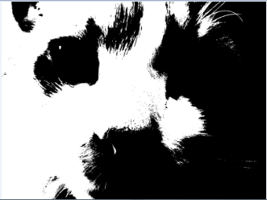

# 7.7 סף בינארי (Thresholding) והיסטוגרמת בהירויות



> 🎬 **דברי המרצים:**  
> *"כיצד ממירים תמונה לשחור-לבן בינארי טהור ללא גווני אפור? פעולה זו נקראת Thresholding ומשמשת לזיהוי טקסט, סריקת מסמכים וזיהוי לוחיות רישוי."*

---

## 1. המרה לסף בינארי (Thresholding)

[](https://colab.research.google.com/github/alonitzkovitch/python_course_book/blob/main/practice/interactive_labs.ipynb)
[](https://kaggle.com/kernels/welcome?src=https://raw.githubusercontent.com/alonitzkovitch/python_course_book/main/practice/interactive_labs.ipynb)


```python
def threshold(im, cutoff=128):
    w, h = im.size
    new_im = Image.new('L', (w, h), 255)
    orig = im.load()
    new_mat = new_im.load()
    
    for x in range(w):
        for y in range(h):
            if orig[x, y] >= cutoff:
                new_mat[x, y] = 255  # לבן
            else:
                new_mat[x, y] = 0    # שחור
                
    return new_im
```

---

## 2. היסטוגרמת בהירויות

הפונקציה `.histogram()` מחזירה רשימה באורך 256 שבה באינדקס $i$ מופיע מספר הפיקסלים שגוונם הוא $i$:

```python
hist = cat_img.histogram()
print("כמות פיקסלים שחורים לגמרי (0):", hist[0])
print("כמות פיקסלים לבנים לגמרי (255):", hist[255])
```

---

## ❓ שאלת הבנה

מה יקרה אם נקבע סף `cutoff = 0` בפונקציית `threshold`?

<details>
<summary><b>לחצו לצפייה בתשובה והסבר</b></summary>

**תשובה:** כל הפיקסלים בתמונה יהפכו ללבנים לחלוטין (כי כולם גדולים או שווים ל-0).
</details>
