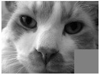

# שיעור 7: ייצוג ועיבוד תמונה דיגיטלית

> **"עבור העין האנושית, תמונה היא מראה צבעוני; עבור המחשב, זוהי בסך הכל מטריצה של מספרים."**

כיצד מחשב רואה, מאחסן ומעבד תמונות?  
בשיעור זה נחקור את עולם עיבוד התמונה הדיגיטלית, נבין כיצד פיקסלים נשמרים בזיכרון ברמות אפור ובצבע, ונממש אלגוריתמי עיבוד תמונה אמיתיים באמצעות ספריית **PIL (Pillow)**.

---

### ⏱️ יחידות הלימוד לפי סדר הקורס בקמפוס IL:
1. **[7.1 איך מחשב מייצג תמונה? פיקסלים ומערכת צירים דיגיטלית](1_image_representation.md)**
2. **[7.2 רמות אפור (8 ביטים, 0-255) מול צבעי RGB (24 ביטים)](2_grayscale_vs_rgb.md)**
3. **[7.3 ספריית PIL (Pillow): פתיחה, מימדים `.size` והמרת גוונים](3_pil_intro.md)**
4. **[7.4 גישה ישירה למטריצת הפיקסלים (`.load()`) ויצירת תמונה `Image.new()`](4_pixel_matrix_access.md)**
5. **[7.5 אלגוריתם היפוך תמונה אנכי (Upside Down)](5_upside_down_algorithm.md)**
6. **[7.6 אלגוריתמי עיבוד תמונה נוספים: מראה אופקית, תשליל (Negative), חיתוך וסיבוב](6_image_transformations.md)**
7. **[7.7 סף בינארי (Thresholding) והיסטוגרמת בהירויות](7_threshold_and_histogram.md)**
8. **[7.8 סיכום שיעור 7, שאלות מעקב ותרגול אינטראקטיבי](8_lesson7_summary_quiz.md)**
