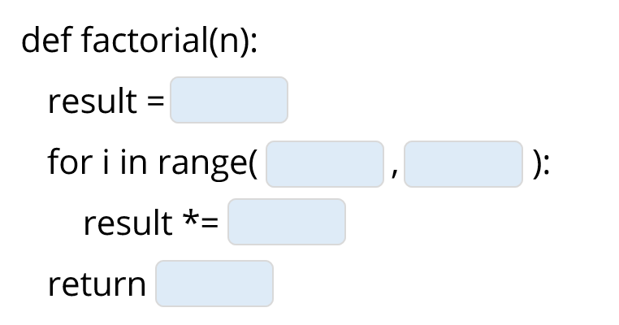

# 1. תרגילי כיתה ומעבדות קוד מודרכות



> 🎬 **טיפ למידה ממרצי הקורס:**  
> אל תמהרו להציץ בפתרון! קחו דף ועט, נתחו את הבעיה, כתבו פסאודו-קוד, הריצו במחברת ובדקו מקרי קצה. רק לאחר שניסיתם בעצמכם – פתחו את הפתרון המלא והשוו את הגישה שלכם לגישת המרצים.


<div class="colab-badge-container" style="margin: 1.2rem 0; display: flex; gap: 12px; flex-wrap: wrap;">
  <a href="https://colab.research.google.com/github/alonitz/python_course_book/blob/main/practice/interactive_practice_labs.ipynb" target="_blank" style="text-decoration:none; display:inline-flex; align-items:center; background:#f8f9fa; border:1px solid #dadce0; border-radius:6px; padding:6px 14px; font-size:13px; font-weight:600; color:#3c4043; box-shadow:0 1px 2px rgba(60,64,67,.15);">
    
    <span>פתח ב-Google Colab (מעבדת תרגילי כיתה)</span>
  </a>
  <a href="https://www.kaggle.com/" target="_blank" style="text-decoration:none; display:inline-flex; align-items:center; background:#20beff; border-radius:6px; padding:6px 14px; font-size:13px; font-weight:600; color:#ffffff; box-shadow:0 1px 2px rgba(0,0,0,.15);">
    <span style="font-size:14px; margin-left:6px;">kaggle</span>
    <span>פתח ב-Kaggle Notebook</span>
  </a>
</div>


---

## תרגיל 1: בדיקת פלינדרום (מחרוזות ואינדקסים)

**הגדרה:** פלינדרום היא מילה או משפט שנקראים בדיוק אותו דבר מימין לשמאל ומשמאל לימין (למשל: `"radar"`, `"level"`, `"kayak"`).

### הדרישה:
כתבו פונקציה בשם `is_palindrome(s)` המקבלת מחרוזת ומחזירה `True` אם היא פלינדרום, ו-`False` אחרת.  
**אתגר נוסף:** הפונקציה צריכה להתעלם מרווחים ומאותיות גדולות/קטנות (למשל המשפט `"A man a plan a canal Panama"` צריך להחזיר `True`!).

<details>
<summary><b>💡 לחצו לצפייה בפתרון המלא עם הסבר</b></summary>

```python
def is_palindrome(s):
    # סינון רווחים והמרה לאותיות קטנות
    clean_s = ""
    for char in s.lower():
        if char.isalnum():  # שומר רק אותיות ומספרים
            clean_s += char
            
    # בדיקה האם המחרוזת הנקייה שווה להיפוך שלה
    return clean_s == clean_s[::-1]

# בדיקות:
print(is_palindrome("radar"))                        # True
print(is_palindrome("hello"))                        # False
print(is_palindrome("A man a plan a canal Panama"))  # True
print(is_palindrome("Was it a car or a cat I saw"))  # True
```

**ניתוח יעילות:**  
* סינון המחרוזת לוקח $O(n)$ פעולות.
* היפוך והשוואת מחרוזת לוקחים $O(n)$ פעולות.
* סיבוכיות כוללת: $O(n)$ זמן ריצה ו-$O(n)$ זיכרון נוסף.
</details>

---

## תרגיל 2: האיבר השני בגודלו ברשימה (רשימות ותנאים)

### הדרישה:
כתבו פונקציה בשם `second_largest(numbers)` המקבלת רשימת מספרים ומחזירה את המספר השני בגודלו בה (ללא כפילויות!).  
אם ברשימה יש פחות משני מספרים שונים (למשל רשימה ריקה, איבר בודד, או רשימה שכל איבריה זהים כמו `[7, 7, 7]`), הפונקציה תחזיר `None`.

**דוגמאות:**
* `second_largest([10, 40, 20, 50, 30])` $
ightarrow$ `40`
* `second_largest([5, 5, 5])` $
ightarrow$ `None`
* `second_largest([100, 20, 100, 40])` $
ightarrow$ `40`

<details>
<summary><b>💡 לחצו לצפייה בפתרון המלא עם הסבר</b></summary>

```python
def second_largest(numbers):
    first = None
    second = None
    
    for num in numbers:
        if first is None or num > first:
            second = first
            first = num
        elif num != first and (second is None or num > second):
            second = num
            
    return second

# בדיקות:
print(second_largest([10, 40, 20, 50, 30]))     # 40
print(second_largest([5, 5, 5]))                 # None
print(second_largest([100, 20, 100, 40]))        # 40
print(second_largest([7]))                       # None
```

**מדוע פתרון זה מעולה?**  
הוא סורק את הרשימה **במעבר אחד בלבד ($O(n)$)** מבלי למיין את הרשימה (מיון היה דורש $O(n \log n)$) ומבלי להקצות זיכרון נוסף ($O(1)$ זיכרון)!
</details>

---

## תרגיל 3: השערת קולץ ($3n + 1$ Collatz Conjecture)

### הדרישה:
השערת קולץ במתמטיקה מתחילה מכל מספר שלם חיובי $n$ ומבצעת את הכללים הבאים:
* אם $n$ זוגי: $n = n // 2$
* אם $n$ אי-זוגי: $n = 3n + 1$
התהליך חוזר על עצמו עד שמגיעים למספר $1$.

כתבו פונקציה בשם `collatz_sequence(n)` המקבלת מספר שלם חיובי ומחזירה את רשימת כל המספרים בסדרה מ-$n$ ועד $1$.  
כמו כן, כתבו פונקציה `longest_collatz(limit)` שמוצאת איזה מספר מ-$1$ ועד `limit` מייצר את הסדרה הארוכה ביותר.

<details>
<summary><b>💡 לחצו לצפייה בפתרון המלא עם הסבר</b></summary>

```python
def collatz_sequence(n):
    sequence = [n]
    while n > 1:
        if n % 2 == 0:
            n = n // 2
        else:
            n = 3 * n + 1
        sequence.append(n)
    return sequence

def longest_collatz(limit):
    max_len = 0
    best_start = 1
    for start in range(1, limit + 1):
        seq_len = len(collatz_sequence(start))
        if seq_len > max_len:
            max_len = seq_len
            best_start = start
    return best_start, max_len

# בדיקה:
print("Collatz(13):", collatz_sequence(13))
# [13, 40, 20, 10, 5, 16, 8, 4, 2, 1]
best_num, steps = longest_collatz(100)
print(f"Longest under 100 is {best_num} with {steps} steps!")
# 97 עם 119 צעדים!
```
</details>

---

## תרגיל 4: ביואינפורמטיקה - חישוב אחוז ה-GC ברצף DNA

### הדרישה:
בביולוגיה חישובית, רצפי DNA מורכבים מ-4 בסיסים: אדנין (`A`), תימין (`T`), גואנין (`G`), וציטוזין (`C`).  
מדד מרכזי ליציבות תרמית של DNA הוא **תכולת ה-GC (GC-content)**, המוגדרת כאחוז הבסיסים שהם `G` או `C` מתוך סך כל הבסיסים:
$$\text{GC-content} = \frac{\#G + \#C}{\text{total bases}} \times 100$$

כתבו פונקציה בשם `gc_content(dna_sequence)` המקבלת מחרוזת ומחזירה את אחוז ה-GC שלה כמספר עשרוני.

<details>
<summary><b>💡 לחצו לצפייה בפתרון המלא עם הסבר</b></summary>

```python
def gc_content(dna_sequence):
    clean_seq = dna_sequence.upper()
    total = len(clean_seq)
    if total == 0:
        return 0.0
        
    gc_count = clean_seq.count('G') + clean_seq.count('C')
    return (gc_count / total) * 100

# בדיקות:
dna = "ATGCATGCATGC"
print(f"GC-content: {gc_content(dna):.2f}%") # 50.00%

poly_gc = "GGCCGGCC"
print(f"GC-content: {gc_content(poly_gc):.2f}%") # 100.00%
```
</details>

---

## תרגיל 5: סכום אלכסונים במטריצה ריבועית

### הדרישה:
כתבו פונקציה בשם `matrix_diagonal_sum(matrix)` המקבלת מטריצה ריבועית בגודל $n \times n$ (מיוצגת כרשימה של רשימות) ומחזירה את סכום שני האלכסונים שלה:
1. **האלכסון הראשי:** האיברים שבהם שורה = עמודה ($matrix[i][i]$).
2. **האלכסון המשני:** האיברים שבהם שורה ועמודה משלימים ל-$n-1$ ($matrix[i][n - 1 - i]$).
*שימו לב:* אם גודל המטריצה אי-זוגי, האיבר המרכזי שייך לשני האלכסונים ויש לספור אותו **פעם אחת בלבד**!

<details>
<summary><b>💡 לחצו לצפייה בפתרון המלא עם הסבר</b></summary>

```python
def matrix_diagonal_sum(matrix):
    n = len(matrix)
    total_sum = 0
    
    for i in range(n):
        # איבר מהאלכסון הראשי
        total_sum += matrix[i][i]
        
        # איבר מהאלכסון המשני (רק אם אינו אותו איבר בדיוק)
        secondary_col = n - 1 - i
        if secondary_col != i:
            total_sum += matrix[i][secondary_col]
            
    return total_sum

# בדיקה:
mat = [
    [1, 2, 3],
    [4, 5, 6],
    [7, 8, 9]
]
# אלכסון ראשי: 1 + 5 + 9 = 15
# אלכסון משני: 3 + 5 + 7 = 15
# סכום ללא כפילות ב-5: 1 + 5 + 9 + 3 + 7 = 25
print("Diagonal sum:", matrix_diagonal_sum(mat)) # 25
```
</details>