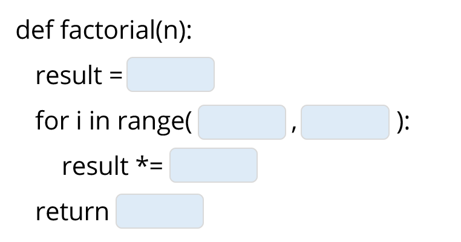

# 3. בוחן אינטראקטיבי מסכם וחישוב קצב למידה (Interactive Scored Exam)

> 🎯 **סימולציית מבחן גמר עם ציון וחישוב קצב למידה בזמן אמת!**  
> לפניכם 15 שאלות מקיפות הבודקות את כל נושאי הקורס.  
> ענו על השאלות, ולחצו בסיום על הכפתור **"בדוק את כל התשובות וחשב ציון"**.  
> המערכת תחשב את ציונכם מתוך 100, תספק **הערכה מדויקת של קצב הלמידה ורמת השליטה שלכם (Learning Rate)**, ותציג הסבר מפורט לכל שאלה.

---

  <!-- Score Board (Hidden initially) -->
  

    

      

        <h2 style="margin: 0; color: #1e293b; font-size: 1.6rem;">📊 תוצאות הבחינה וקצב הלמידה</h2>
        
ניתוח ביצועים אישי על פי 15 שאלות הקורס

      

      

        ציון סופי
        0
         / 100
      

    

    <!-- Learning Rate / Mastery Evaluation Card -->
    

      <h3 id="mastery-title" style="margin: 0 0 8px 0; font-size: 1.25rem;"></h3>
      

    

    

      
✅ תשובות נכונות: <strong id="correct-count" style="color: #16a34a;">0</strong>

      
❌ תשובות שגויות: <strong id="incorrect-count" style="color: #dc2626;">0</strong>

      
⚪ לא נענו: <strong id="unanswered-count" style="color: #94a3b8;">0</strong>

    

  

  <!-- QUESTIONS FORM -->
  <form id="quiz-form">

    <!-- Q1 -->
    

      <h4 style="margin-top:0; color:#0f172a;">1. מה יהיה הפלט של השורה הבאה בפייתון? <code style="direction:ltr; display:inline-block;">print(3 + 2 * 2 ** 3)</code></h4>
      

        <label style="display:block; margin:8px 0; cursor:pointer;"><input type="radio" name="q1" value="a"> א. 103</label>
        <label style="display:block; margin:8px 0; cursor:pointer;"><input type="radio" name="q1" value="b"> ב. 19</label>
        <label style="display:block; margin:8px 0; cursor:pointer;"><input type="radio" name="q1" value="c"> ג. 40</label>
        <label style="display:block; margin:8px 0; cursor:pointer;"><input type="radio" name="q1" value="d"> ד. 131</label>
      

      

    

    <!-- Q2 -->
    

      <h4 style="margin-top:0; color:#0f172a;">2. נתונה המחרוזת <code style="direction:ltr; display:inline-block;">s = "ComputerScience"</code>. מה יחזיר הביטוי <code style="direction:ltr; display:inline-block;">s[1:8:2]</code>?</h4>
      

        <label style="display:block; margin:8px 0; cursor:pointer;"><input type="radio" name="q2" value="a"> א. "opte"</label>
        <label style="display:block; margin:8px 0; cursor:pointer;"><input type="radio" name="q2" value="b"> ב. "Cmue"</label>
        <label style="display:block; margin:8px 0; cursor:pointer;"><input type="radio" name="q2" value="c"> ג. "oues"</label>
        <label style="display:block; margin:8px 0; cursor:pointer;"><input type="radio" name="q2" value="d"> ד. "puter"</label>
      

      

    

    <!-- Q3 -->
    

      <h4 style="margin-top:0; color:#0f172a;">3. באלגוריתם גייל-שפלי (Gale-Shapley) לשידוך יציב, מה נכון תמיד לגבי השידוך הסופי?</h4>
      

        <label style="display:block; margin:8px 0; cursor:pointer;"><input type="radio" name="q3" value="a"> א. כולם מקבלים את האפשרות הראשונה ברשימת ההעדפות שלהם.</label>
        <label style="display:block; margin:8px 0; cursor:pointer;"><input type="radio" name="q3" value="b"> ב. לא קיים אף זוג חוסם (זוג שמעדיף זה את זו על פני בני הזוג שהוקצו להם).</label>
        <label style="display:block; margin:8px 0; cursor:pointer;"><input type="radio" name="q3" value="c"> ג. האלגוריתם עלול להיכנס ללולאה אינסופית אם ההעדפות אינן מעגליות.</label>
        <label style="display:block; margin:8px 0; cursor:pointer;"><input type="radio" name="q3" value="d"> ד. הנשים תמיד זוכות לשידוך המועדף עליהן ביותר כאשר הגברים הם המציעים.</label>
      

      

    

    <!-- Q4 -->
    

      <h4 style="margin-top:0; color:#0f172a;">4. מה יהיה הפלט של קטע הקוד הבא?</h4>
      <pre style="direction:ltr; background:#f1f5f9; padding:10px; border-radius:6px;">a = [1, 2, 3]
b = a
b.append(4)
print(len(a))</pre>
      

        <label style="display:block; margin:8px 0; cursor:pointer;"><input type="radio" name="q4" value="a"> א. 3</label>
        <label style="display:block; margin:8px 0; cursor:pointer;"><input type="radio" name="q4" value="b"> ב. 4</label>
        <label style="display:block; margin:8px 0; cursor:pointer;"><input type="radio" name="q4" value="c"> ג. השגיאה TypeError</label>
        <label style="display:block; margin:8px 0; cursor:pointer;"><input type="radio" name="q4" value="d"> ד. 1</label>
      

      

    

    <!-- Q5 -->
    

      <h4 style="margin-top:0; color:#0f172a;">5. מה הערך שמחזיר הביטוי הבא בזכות מנגנון קיצור הדרך הלוגי (Short-circuit evaluation)?</h4>
      <pre style="direction:ltr; background:#f1f5f9; padding:10px; border-radius:6px;">True or (10 / 0 == 0)</pre>
      

        <label style="display:block; margin:8px 0; cursor:pointer;"><input type="radio" name="q5" value="a"> א. ZeroDivisionError</label>
        <label style="display:block; margin:8px 0; cursor:pointer;"><input type="radio" name="q5" value="b"> ב. True</label>
        <label style="display:block; margin:8px 0; cursor:pointer;"><input type="radio" name="q5" value="c"> ג. False</label>
        <label style="display:block; margin:8px 0; cursor:pointer;"><input type="radio" name="q5" value="d"> ד. None</label>
      

      

    

    <!-- Q6 -->
    

      <h4 style="margin-top:0; color:#0f172a;">6. מה יודפס בעת הרצת הקוד הבא העוסק בטווח הכרה (Scope) של משתנים?</h4>
      <pre style="direction:ltr; background:#f1f5f9; padding:10px; border-radius:6px;">x = 10
def modify(x):
    x = 20
    return x * 2

modify(x)
print(x)</pre>
      

        <label style="display:block; margin:8px 0; cursor:pointer;"><input type="radio" name="q6" value="a"> א. 40</label>
        <label style="display:block; margin:8px 0; cursor:pointer;"><input type="radio" name="q6" value="b"> ב. 20</label>
        <label style="display:block; margin:8px 0; cursor:pointer;"><input type="radio" name="q6" value="c"> ג. 10</label>
        <label style="display:block; margin:8px 0; cursor:pointer;"><input type="radio" name="q6" value="d"> ד. UnboundLocalError</label>
      

      

    

    <!-- Q7 -->
    

      <h4 style="margin-top:0; color:#0f172a;">7. כמה פעמים יודפס הביטוי "Campus" בעת הרצת הלולאות הבאות?</h4>
      <pre style="direction:ltr; background:#f1f5f9; padding:10px; border-radius:6px;">for i in range(3):
    for j in range(2, 5):
        print("Campus")</pre>
      

        <label style="display:block; margin:8px 0; cursor:pointer;"><input type="radio" name="q7" value="a"> א. 15</label>
        <label style="display:block; margin:8px 0; cursor:pointer;"><input type="radio" name="q7" value="b"> ב. 9</label>
        <label style="display:block; margin:8px 0; cursor:pointer;"><input type="radio" name="q7" value="c"> ג. 6</label>
        <label style="display:block; margin:8px 0; cursor:pointer;"><input type="radio" name="q7" value="d"> ד. 12</label>
      

      

    

    <!-- Q8 -->
    

      <h4 style="margin-top:0; color:#0f172a;">8. מה יהיה הפלט של הלולאה הבאה?</h4>
      <pre style="direction:ltr; background:#f1f5f9; padding:10px; border-radius:6px;">count = 0
n = 16
while n > 1:
    n = n // 2
    count += 1
print(count)</pre>
      

        <label style="display:block; margin:8px 0; cursor:pointer;"><input type="radio" name="q8" value="a"> א. 4</label>
        <label style="display:block; margin:8px 0; cursor:pointer;"><input type="radio" name="q8" value="b"> ב. 5</label>
        <label style="display:block; margin:8px 0; cursor:pointer;"><input type="radio" name="q8" value="c"> ג. 16</label>
        <label style="display:block; margin:8px 0; cursor:pointer;"><input type="radio" name="q8" value="d"> ד. 3</label>
      

      

    

    <!-- Q9 -->
    

      <h4 style="margin-top:0; color:#0f172a;">9. באלגוריתם המשופר לבדיקת ראשוניות של מספר $n$, עד איזה ערך מספיק לבדוק מחלקים פוטנציאליים?</h4>
      

        <label style="display:block; margin:8px 0; cursor:pointer;"><input type="radio" name="q9" value="a"> א. עד n - 1</label>
        <label style="display:block; margin:8px 0; cursor:pointer;"><input type="radio" name="q9" value="b"> ב. עד n // 2</label>
        <label style="display:block; margin:8px 0; cursor:pointer;"><input type="radio" name="q9" value="c"> ג. עד שורש המספר (int(n ** 0.5))</label>
        <label style="display:block; margin:8px 0; cursor:pointer;"><input type="radio" name="q9" value="d"> ד. עד log(n)</label>
      

      

    

    <!-- Q10 -->
    

      <h4 style="margin-top:0; color:#0f172a;">10. איזה מהערכים הבאים **אינו חוקי** לשמש כמפתח (Key) במילון בפייתון?</h4>
      

        <label style="display:block; margin:8px 0; cursor:pointer;"><input type="radio" name="q10" value="a"> א. המחרוזת "student_id"</label>
        <label style="display:block; margin:8px 0; cursor:pointer;"><input type="radio" name="q10" value="b"> ב. המספר השלם 42</label>
        <label style="display:block; margin:8px 0; cursor:pointer;"><input type="radio" name="q10" value="c"> ג. ה-Tuple הבא: (1, "A")</label>
        <label style="display:block; margin:8px 0; cursor:pointer;"><input type="radio" name="q10" value="d"> ד. הרשימה: [1, 2, 3]</label>
      

      

    

    <!-- Q11 -->
    

      <h4 style="margin-top:0; color:#0f172a;">11. בעת קריאת שורה מקובץ CSV באמצעות <code style="direction:ltr; display:inline-block;">line.strip().split(',')</code>, מה יהיה טיפוס הנתונים של כל איבר ברשימה שנוצרת?</h4>
      

        <label style="display:block; margin:8px 0; cursor:pointer;"><input type="radio" name="q11" value="a"> א. פייתון ממירה אוטומטית מספרים ל-int או float ומילים ל-str</label>
        <label style="display:block; margin:8px 0; cursor:pointer;"><input type="radio" name="q11" value="b"> ב. כל האיברים הם תמיד מחרוזות (str), וחובה להמירם ידנית אם נדרש חישוב מתמטי</label>
        <label style="display:block; margin:8px 0; cursor:pointer;"><input type="radio" name="q11" value="c"> ג. כל האיברים מומרים לרשימות מקוננות</label>
        <label style="display:block; margin:8px 0; cursor:pointer;"><input type="radio" name="q11" value="d"> ד. טיפוס מיוחד בשם csv_row</label>
      

      

    

    <!-- Q12 -->
    

      <h4 style="margin-top:0; color:#0f172a;">12. בקובץ הצעדים <code style="direction:ltr; display:inline-block;">steps_per_minute.csv</code> נרשמו צעדים בכל דקה במשך שבועיים. כמה שורות נתונים (ללא שורת כותרת) יש בקובץ?</h4>
      

        <label style="display:block; margin:8px 0; cursor:pointer;"><input type="radio" name="q12" value="a"> א. 1,440 שורות</label>
        <label style="display:block; margin:8px 0; cursor:pointer;"><input type="radio" name="q12" value="b"> ב. 17,280 שורות (12 ימי מדידה פעילים $\times 1440$ דקות ביממה)</label>
        <label style="display:block; margin:8px 0; cursor:pointer;"><input type="radio" name="q12" value="c"> ג. 100,000 שורות</label>
        <label style="display:block; margin:8px 0; cursor:pointer;"><input type="radio" name="q12" value="d"> ד. 24 שורות</label>
      

      

    

    <!-- Q13 -->
    

      <h4 style="margin-top:0; color:#0f172a;">13. בספריית Matplotlib, איזה סוג גרף הוא המתאים ביותר להצגת **התפלגות תדירויות (Distribution)** של משתנה רציף (כגון חלוקת קצבי הליכה)?</h4>
      

        <label style="display:block; margin:8px 0; cursor:pointer;"><input type="radio" name="q13" value="a"> א. plt.scatter</label>
        <label style="display:block; margin:8px 0; cursor:pointer;"><input type="radio" name="q13" value="b"> ב. plt.hist (היסטוגרמה עם bins)</label>
        <label style="display:block; margin:8px 0; cursor:pointer;"><input type="radio" name="q13" value="c"> ג. plt.plot</label>
        <label style="display:block; margin:8px 0; cursor:pointer;"><input type="radio" name="q13" value="d"> ד. plt.imshow</label>
      

      

    

    <!-- Q14 -->
    

      <h4 style="margin-top:0; color:#0f172a;">14. בספריית PIL (Pillow), כאשר קוראים פיקסל בתמונה בעזרת <code style="direction:ltr; display:inline-block;">mat[x, y]</code>:</h4>
      

        <label style="display:block; margin:8px 0; cursor:pointer;"><input type="radio" name="q14" value="a"> א. x מייצג שורה (רוחב), ו-y מייצג עמודה (גובה)</label>
        <label style="display:block; margin:8px 0; cursor:pointer;"><input type="radio" name="q14" value="b"> ב. x מייצג את העמודה האופקית (רוחב מ-0 עד width-1), ו-y מייצג את השורה האנכית (גובה מ-0 עד height-1)</label>
        <label style="display:block; margin:8px 0; cursor:pointer;"><input type="radio" name="q14" value="c"> ג. הראשית (0,0) ממוקמת בפינה הימנית התחתונה</label>
        <label style="display:block; margin:8px 0; cursor:pointer;"><input type="radio" name="q14" value="d"> ד. x ו-y תמיד חייבים להיות שווים</label>
      

      

    

    <!-- Q15 -->
    

      <h4 style="margin-top:0; color:#0f172a;">15. כדי ליצור תמונת "נגטיב" (Negative) מתמונת גווני אפור של 8-ביט (ערכים מ-0 עד 255), מהו הערך החדש של פיקסל בעל בהירות מקורית p?</h4>
      

        <label style="display:block; margin:8px 0; cursor:pointer;"><input type="radio" name="q15" value="a"> א. 255 - p</label>
        <label style="display:block; margin:8px 0; cursor:pointer;"><input type="radio" name="q15" value="b"> ב. -p</label>
        <label style="display:block; margin:8px 0; cursor:pointer;"><input type="radio" name="q15" value="c"> ג. 256 // p</label>
        <label style="display:block; margin:8px 0; cursor:pointer;"><input type="radio" name="q15" value="d"> ד. p % 255</label>
      

      

    

    <!-- ACTION BUTTONS -->
    

      <button type="button" id="submit-quiz-btn" onclick="gradeInteractiveQuiz()" style="background:#2563eb; color:#fff; border:none; padding:12px 28px; border-radius:8px; font-size:1.1rem; font-weight:bold; cursor:pointer; box-shadow:0 2px 6px rgba(37,99,235,0.3);">
        🚀 בדוק את כל התשובות וחשב ציון
      </button>
      <button type="button" onclick="resetInteractiveQuiz()" style="background:#f1f5f9; color:#475569; border:1px solid #cbd5e1; padding:12px 22px; border-radius:8px; font-size:1rem; font-weight:600; cursor:pointer;">
        🔄 אפס בוחן ונסה שוב
      </button>
    

  </form>

