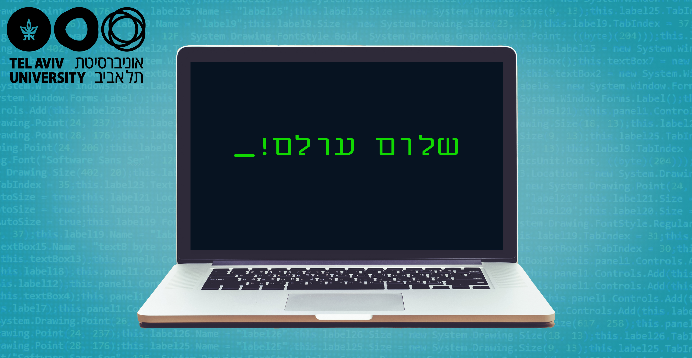

# מדריך למידה: כיצד להצליח בקורס

  

    🎬 הרצאת וידאו: פרומו והיכרות עם קורס צעדים ראשונים בפייתון
    מרצה: פרופ' בני שור וד"ר אמיר רובינשטיין | אוניברסיטת תל אביב
  

  

    <iframe 
      src="https://www.youtube-nocookie.com/embed/dQWtmzjHI2A" 
      title="פרומו והיכרות עם קורס צעדים ראשונים בפייתון" 
      style="position: absolute; top: 0; left: 0; width: 100%; height: 100%; border:0;" 
      allow="accelerometer; autoplay; clipboard-write; encrypted-media; gyroscope; picture-in-picture" 
      allowfullscreen>
    </iframe>
  

  

    🔗 <a href="https://www.youtube.com/watch?v=dQWtmzjHI2A" target="_blank" style="color: #2563eb; text-decoration: none;">Watch on YouTube</a> | 
    <a href="https://www.youtube.com/playlist?list=PLZkJ6lmZSF_ylSMai1DAB1T2nRAK8Q_RA" target="_blank" style="color: #2563eb; text-decoration: none;">TAU Full Course Playlist</a>
  

> מסמך זה מבוסס על חוברת ההנחיות והטיפים של צוות ההוראה של אוניברסיטת תל אביב ("כיצד להצליח בקורס").  
> תכנות הוא מיומנות שנרכשת דרך עשייה – קראו בעיון את הכללים שלפניכם כדי להפיק את המרב מתהליך הלמידה.

---

## 1. למידה אקטיבית מול למידה פסיבית

בלימודי מדעי המחשב, קריאה פסיבית או צפייה שקטה בסרטונים **איננה אפקטיבית**. המוח שלנו קולט מידע באופן עמוק רק כאשר אנחנו מפעילים אותו באופן יזום:

* **הקלידו בעצמכם:** אל תסתפקו בהעתקה והדבקה (Copy-Paste) של קטעי הקוד. הקלדת שורות הקוד בעצמכם מפתחת זיכרון שריר, גורמת לכם לשים לב לסימני פיסוק (נקודתיים, סוגריים, רווחים והזחות) ומחייבת אתכם לעבד כל פקודה.
* **עצרו וחשבו לפני התוצאה:** בכל פעם שאתם פוגשים קטע קוד בספר, נחשו קודם מה יהיה הפלט שלו. רק לאחר שניחשתם, בדקו את התשובה. אם טעיתם – בדקו מדוע!
* **שנו את הקוד ו"שברו" אותו:** מה קורה אם מחליפים `<` ב-`<=`? מה קורה אם שוכחים להגדיר משתנה? מה קורה כשמזינים מספר שלילי או מחרוזת ריקה? ניסוי וטעייה הם המפתח להבנה עמוקה של שפת תכנות.

:::{tip} תרגלו "דיבאגינג עם ברווז גומי" (Rubber Duck Debugging)
אם הקוד שלכם לא עובד או שאתם מתקשים להבין פונקציה מסוימת, נסו להסביר בקול רם, שורה אחר שורה, מה כל פקודה עושה. תוכלו להסביר לחבר, לקיר, או לבובת גומי על השולחן – עצם ההסבר המילולי של הקוד מציף פעמים רבות את מקור השגיאה!
:::

---

## 2. תכנון זמנים וחלוקת עומס

לימוד שפת תכנות דומה ללימוד שפה מדוברת חדשה או נגינה בכלי מוזיקלי:
* **הימנעו ממרתונים:** אל תנסו ללמוד את כל הקורס בסוף שבוע אחד. שעתיים של למידה מרוכזת שלוש פעמים בשבוע עדיפות פי כמה על מרתון של שמונה שעות רצופות שבו החומר מתערבב.
* **חזרה ועיבוד:** הקדישו בכל שיעור כ-15 דקות לחזרה על מושגים משיעורים קודמים. תכנות בנוי בצורה מצטברת (Layered) – לא תוכלו להבין פונקציות בלי להבין משתנים, ולא תוכלו להבין לולאות מקוננות בלי לשלוט ברשימות.
* **הפסקות יזומות:** כשאתם נתקלים בבאג עקשן ושום דבר לא עובד, קחו הפסקה של 20 דקות, צאו לסיבוב או שתו כוס מים. לעיתים קרובות, הפתרון ינצנץ בראשכם דווקא כשתתרחקו מהמסך.

---

## 3. התמודדות עם הודעות שגיאה (Error Messages)

מתכנתים מתחילים רבים נבהלים כשהם רואים הודעת שגיאה אדומה וארוכה שנפלטת מהמסוף.

:::{important} זכרו תמיד!
**שגיאה איננה כישלון – היא המורה הטוב ביותר שלכם.** שפת פייתון אינה "כועסת" עליכם; היא פשוט מנסה להגיד לכם בדיוק היכן נתקלה בקושי ומה חסר לה כדי להמשיך.
:::

כאשר מופיעה שגיאה:
1. **קראו את השורה האחרונה בהודעת השגיאה:** שם מופיעים סוג השגיאה והתיאור שלה (למשל: `ZeroDivisionError: division by zero` או `NameError: name 'x' is not defined`).
2. **בדקו את מספר השורה:** פייתון מציינת במפורש באיזו שורה בתוכנית התרחשה השגיאה (`line 4`).
3. **הבדילו בין סוגי השגיאות:**
   * **שגיאות תחביר (`SyntaxError`):** טעות בכללי הכתיבה (למשל שכחתם נקודתיים `:` בסוף שורת `if` או סגירת מרכאות).
   * **שגיאות זמן ריצה (`RuntimeError`):** הקוד תקין תחבירית, אך בעת ההרצה התרחש דבר לא חוקי (כמו חלוקה באפס או גישה לאינדקס שלא קיים ברשימה).
   * **שגיאות לוגיות (`Logical Bugs`):** התוכנית רצה עד סופה ללא שום הודעת שגיאה, אך מפיקה תוצאה שגויה. שגיאות אלו הן המאתגרות ביותר לאיתור.

---

## 4. מבנה הציונים והערכה בקורס המקורי

בקורס האקדמי בקמפוס IL ובאוניברסיטת תל אביב, חלוקת הציון היא:

| סוג המשימה | משקל בציון הסופי | פירוט |
| :--- | :---: | :--- |
| **8 בחנים שוטפים** | **40%** | בחנים קצרים בסיום כל יחידת לימוד (2 ניסיונות מענה) |
| **מבחן אמצע (Midterm)** | **20%** | בוחן מקיף על ארבעת השיעורים הראשונים (שיעורים 1-4) |
| **מבחן מסכם (Final)** | **40%** | בחינה אקדמית מסכמת על כלל חומרי הקורס |
| **סה"כ** | **100%** | ציון עובר אקדמי: 60 ומעלה |

בספר זה שילבנו עבורכם בוחן אמצע מקיף עם פתרונות, תרגילי כיתה מדורגים, ושאלות חזרה למבחן המסכם כדי שתוכלו לבחון את עצמכם בדיוק באותה רמה!